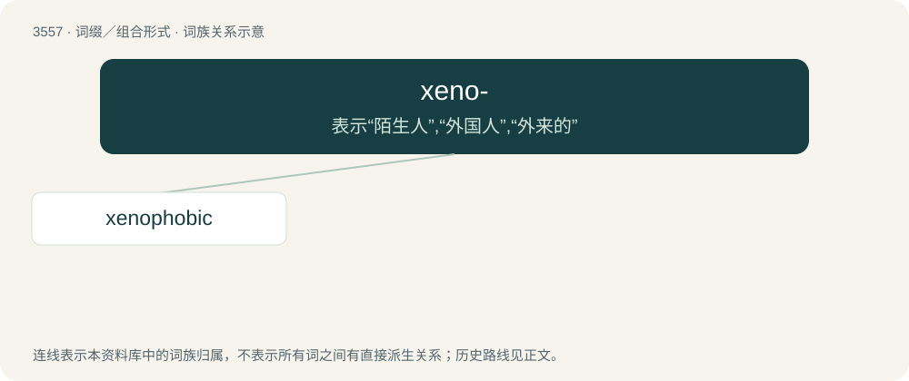

# 3628 · xeno- — 表示“陌生人”,“外国人”,“外来的”

[总目录](../00_总目录_按常用程度.md)

**类型**：词缀／组合形式　｜　**来源语言**：见词源记录

## 核心含义与来源

- 核心含义：表示“陌生人”,“外国人”,“外来的”
- 英文含义：Having to do with foreigners.
- 词形：xeno-

**来源记录 1**（前缀／前置成分；Having to do with foreigners.）

Derived from Ancient Greek ξένος (xénos, “foreign, of a stranger”).

## 词族图

## 单词速览（常用到不常用）

| 单词 | 音标 | 释义 |
|---|---|---|
| [xenophobic](#w-1) | 英 /ˌzɛn.əˈfəʊ.bɪk/；美 /ˌzi.nəˈfoʊ.bɪk/ | a. 畏惧和憎恨外国人的；\[法\] 仇外的, 恐惧外国人的 |

## 逐词详解

### 1. xenophobic

**词性**：形容词　｜　**音标**：英 /ˌzɛn.əˈfəʊ.bɪk/；美 /ˌzi.nəˈfoʊ.bɪk/

**中文释义**：a. 畏惧和憎恨外国人的；\[法\] 仇外的, 恐惧外国人的

**英文义项**：Exhibiting or characterised by xenophobia, a fear or hatred of strangers, foreigners, or extraterrestial life.

**构词拆分**：xeno- + -phobic

**词源与演化**：

From xeno- + -phobic, from Ancient Greek ξένος (xénos, “foreign, strange”) + φόβος (phóbos, “fear”).

**例句**：

> Apropos of nothing, Tom went on an unhinged xenophobic rant.
