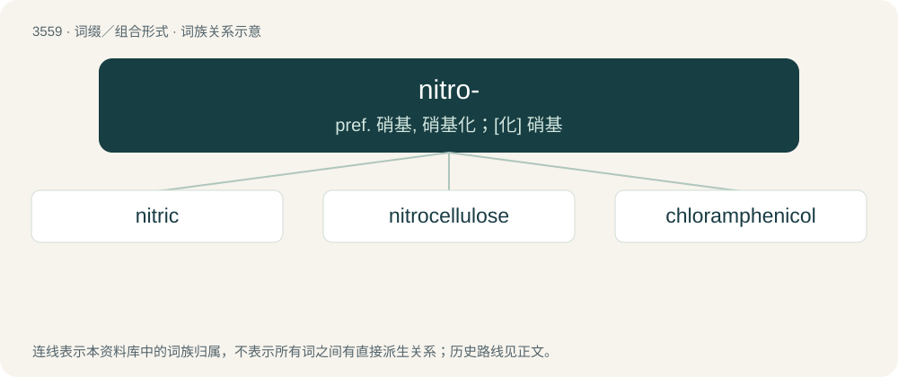

# 3630 · nitro- — pref. 硝基, 硝基化；\[化\] 硝基

[总目录](../00_总目录_按常用程度.md)

**类型**：词缀／组合形式　｜　**来源语言**：见词源记录

## 核心含义与来源

- 核心含义：pref. 硝基, 硝基化；\[化\] 硝基
- 英文含义：nitrate, nitrogen
- 词形：nitro-

**来源记录 1**（前缀／前置成分；nitrate, nitrogen）

From Ancient Greek νίτρον (nítron). See niter.

## 词族图

## 单词速览（常用到不常用）

| 单词 | 音标 | 释义 |
|---|---|---|
| [nitric](#w-1) | /ˈnaɪtɹɪk/ | a. 氮的, 含氮的, 硝石的 |
| [nitrocellulose](#w-2) | /.naitrəˈseljələus/ | n. 硝化纤维；\[化\] 硝酸纤维素 |
| [chloramphenicol](#w-3) | 英 /ˌklɔː.ɹamˈfɛ.nɪ.kɒl/；美 /ˌklɔˌɹæmˈfɛ.nɪˌkɔl/ | n. 氯霉素；\[化\] 氯霉素 |

## 逐词详解

### 1. nitric

**词性**：形容词　｜　**音标**：/ˈnaɪtɹɪk/

**中文释义**：a. 氮的, 含氮的, 硝石的

**英文义项**：Of, pertaining to, or containing, nitrogen.

**构词拆分**：nitro- + -ic

**词源与演化**：

From nitro- + -ic, compare French nitrique.

**例句**：

> In these flasks are various acids: vinegar, sulfuric acid, nitric acid, and others.

### 2. nitrocellulose

**词性**：名词　｜　**音标**：/.naitrəˈseljələus/

**中文释义**：n. 硝化纤维；\[化\] 硝酸纤维素

**英文义项**：A cotton-like material, made from cellulose by the action of nitric and sulphuric acids, used in the manufacture of explosives, collodion etc.

**构词拆分**：nitro- + cellulose

**词源与演化**：

From nitro- + cellulose.

### 3. chloramphenicol

**词性**：名词　｜　**音标**：英 /ˌklɔː.ɹamˈfɛ.nɪ.kɒl/；美 /ˌklɔˌɹæmˈfɛ.nɪˌkɔl/

**中文释义**：n. 氯霉素；\[化\] 氯霉素

**英文义项**：A broad-spectrum antibiotic C₁₁H₁₂Cl₂N₂O₅ isolated from cultures of a soil actinomycete (Streptomyces venezuelae) or prepared synthetically and used against serious infections such as typhoid fever.

**构词拆分**：chlor- + amide + phen- + nitro- + glycol

**词源与演化**：

From chlor- + am(ide) + phen- + ni(tro)- + (gly)col.
