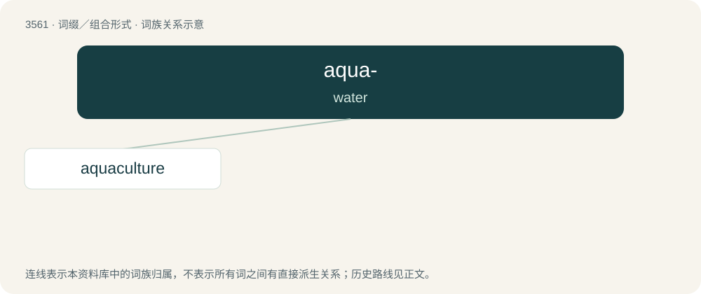

# 3635 · aqua- — water

[总目录](../00_总目录_按常用程度.md)

**类型**：词缀／组合形式　｜　**来源语言**：见词源记录

## 核心含义与来源

- 核心含义：water
- 英文含义：water
- 词形：aqua-

**来源记录 1**（前缀／前置成分；water）

From Middle English aqua (“water”), borrowed from Latin aqua

## 词族图

## 单词速览（常用到不常用）

| 单词 | 音标 | 释义 |
|---|---|---|
| [aquaculture](#w-1) | 英 /ˈækwəˌkʌlt͡ʃə/；美 /ˈækwəˌkʌlt͡ʃɚ/ | n. 水产养殖 |

## 逐词详解

### 1. aquaculture

**词性**：名词　｜　**音标**：英 /ˈækwəˌkʌlt͡ʃə/；美 /ˈækwəˌkʌlt͡ʃɚ/

**中文释义**：n. 水产养殖

**英文义项**：The cultivation of aquatic produce such as aquatic plants, fish, and other aquatic animals.

**构词拆分**：aqua- + culture

**词源与演化**：

From aqua- + culture.

**例句**：

> Aquaculture is the breeding, rearing, and harvesting of fish, shellfish, plants, algae and other organisms in all types of water environments.
