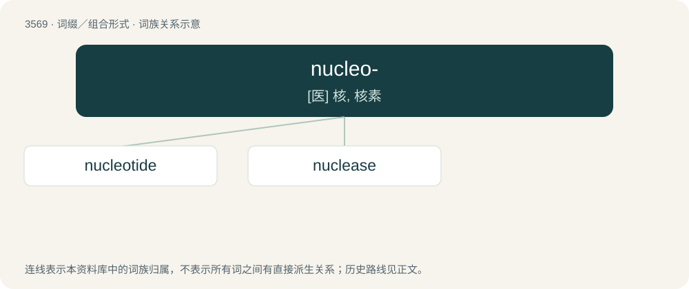

# 3639 · nucleo- — \[医\] 核, 核素

[总目录](../00_总目录_按常用程度.md)

**类型**：词缀／组合形式　｜　**来源语言**：见词源记录

## 核心含义与来源

- 核心含义：\[医\] 核, 核素
- 英文含义：Forming words pertaining to the cell nucleus or to nucleic acid.
- 词形：nucleo-

## 词族图

## 单词速览（常用到不常用）

| 单词 | 音标 | 释义 |
|---|---|---|
| [nucleotide](#w-1) | 美 /ˈn(j)u(ː)kliəˌtaɪd/；/ˈn(j)u(ː)kliəˌtaɪd/ | n. 核苷酸；\[化\] 核苷酸 |
| [nuclease](#w-2) | /ˈnjuːkli,eis/ | n. \[生化\]核酸酶 |

## 逐词详解

### 1. nucleotide

**词性**：名词　｜　**音标**：美 /ˈn(j)u(ː)kliəˌtaɪd/；/ˈn(j)u(ː)kliəˌtaɪd/

**中文释义**：n. 核苷酸；\[化\] 核苷酸

**英文义项**：The monomer constituting DNA or RNA biopolymer molecules. Each nucleotide consists of a nitrogenous heterocyclic base (or nucleobase), which can be either a double-ringed purine or a single-ringed pyrimidine; a five-carbon pentose sugar (deoxyribose in DNA or ribose in RNA); and a phosphate group.

**构词拆分**：nucleo- + -ide

**词源与演化**：

From nucleo- (“relating to the nucleus”) + -ide (“chemical suffix”).

### 2. nuclease

**词性**：名词　｜　**音标**：/ˈnjuːkli,eis/

**中文释义**：n. \[生化\]核酸酶

**英文义项**：Any of several enzymes capable of cleaving the phosphodiester bonds between the nucleotide subunits of nucleic acids.

**构词拆分**：nucleo- + -ase

**词源与演化**：

From nucleo- + -ase.
