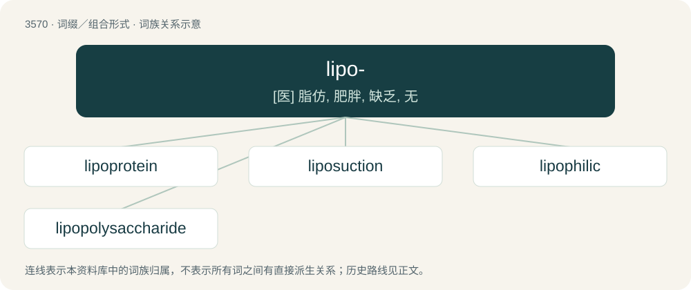

# 3640 · lipo- — \[医\] 脂仿, 肥胖, 缺乏, 无

[总目录](../00_总目录_按常用程度.md)

**类型**：词缀／组合形式　｜　**来源语言**：见词源记录

## 核心含义与来源

- 核心含义：\[医\] 脂仿, 肥胖, 缺乏, 无
- 英文含义：lipids: oils, cholesterols, fat/lard, tallow, and so on.
- 词形：lipo-

**多个词源／构词路径**：同一拼写可能有不同来源；以下按词性和含义分别列出。

**来源记录 1**（前缀／前置成分；lipids: oils, cholesterols, fat/lard, tallow, and so on.）

From international scientific vocabulary, reflecting a New Greek combining form, from Ancient Greek λῐ́πος (lĭ́pos, “animal fat”).

**来源记录 2**（前缀／前置成分；lacking）

From Ancient Greek λείπω (leípō, “to leave, be lacking”).

## 词族图

## 单词速览（常用到不常用）

| 单词 | 音标 | 释义 |
|---|---|---|
| [lipoprotein](#w-1) | 英 /ˌlai.pəʊˈpɹəʊ.tiːn/；美 /ˌlai.poʊˈpɹoʊ.tiːn/ | n. 脂蛋白；\[化\] 脂蛋白 |
| [liposuction](#w-2) | /ˈlai.poʊˌsʌk.ʃn̩/ | 脂肪抽吸\[术\] |
| [lipophilic](#w-3) | /.lipəuˈfilik/ | a. 亲脂性的；\[化\] 亲油的; 亲脂的 |
| [lipopolysaccharide](#w-4) | /ˈlipəj,pɔliˈsækəraid,ˈlai-/ | n. \[生化\]脂多糖 |

## 逐词详解

### 1. lipoprotein

**词性**：名词　｜　**音标**：英 /ˌlai.pəʊˈpɹəʊ.tiːn/；美 /ˌlai.poʊˈpɹoʊ.tiːn/

**中文释义**：n. 脂蛋白；\[化\] 脂蛋白

**英文义项**：Any of a large group of complexes of protein and lipid with many biochemical functions.

**构词拆分**：lipo- + protein

**词源与演化**：

From lipo- + protein.

**例句**：

> Low-density lipoprotein is bad for your health.

### 2. liposuction

**词性**：名词　｜　**音标**：/ˈlai.poʊˌsʌk.ʃn̩/

**中文释义**：脂肪抽吸\[术\]

**英文义项**：A cosmetic surgery procedure in which excess fat is removed from a specific area by suction.

**构词拆分**：lipo- + suction

**词源与演化**：

From lipo- + suction.

**例句**：

> Sami is still recovering from liposuction.

### 3. lipophilic

**词性**：形容词　｜　**音标**：/.lipəuˈfilik/

**中文释义**：a. 亲脂性的；\[化\] 亲油的; 亲脂的

**英文义项**：Having the quality of dissolving in lipids; typically composed of mostly nonpolar bonds.

**构词拆分**：lipo- (“lipid”) + -philic (“loving”)

**词源与演化**：

From lipo- (“lipid”) + -philic (“loving”).

### 4. lipopolysaccharide

**词性**：名词　｜　**音标**：/ˈlipəj,pɔliˈsækəraid,ˈlai-/

**中文释义**：n. \[生化\]脂多糖

**英文义项**：Any of a large class of lipids conjugated with polysaccharides

**构词拆分**：lipo- + polysaccharide

**词源与演化**：

From lipo- + polysaccharide.
