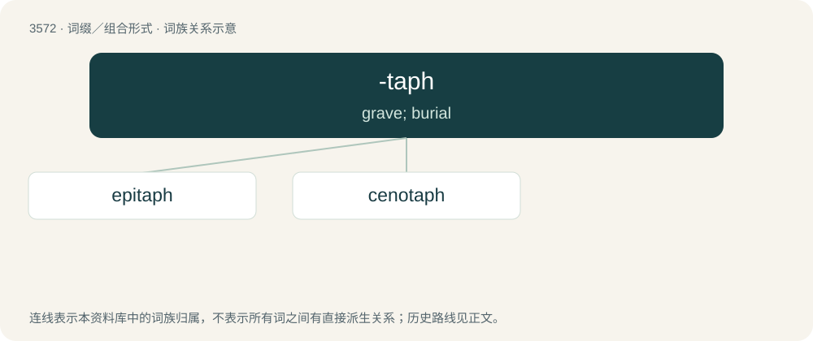

# 3641 · -taph — grave; burial

[总目录](../00_总目录_按常用程度.md)

**类型**：词缀／组合形式　｜　**来源语言**：见词源记录

## 核心含义与来源

- 核心含义：grave; burial
- 英文含义：grave; burial
- 词形：-taph

**来源记录 1**（后缀／后置成分；grave; burial）

From Ancient Greek τάφος (táphos, “grave”) as a final member of compounds. Doublet of tapho-.

## 词族图

## 单词速览（常用到不常用）

| 单词 | 音标 | 释义 |
|---|---|---|
| [epitaph](#w-1) | 英 /ˈɛp.ɪˌtɑːf/；美 /ˈɛp.ɪˌtæf/ | n. 墓志铭, 碑文 |
| [cenotaph](#w-2) | 英 /ˈsɛn.əˌtɑːf/；美 /ˈsɛn.əˌtæf/ | n. 纪念碑, 衣冠冢 |

## 逐词详解

### 1. epitaph

**词性**：名词　｜　**音标**：英 /ˈɛp.ɪˌtɑːf/；美 /ˈɛp.ɪˌtæf/

**中文释义**：n. 墓志铭, 碑文

**英文义项**：An inscription on a gravestone in memory of the deceased. / A poem or other short text written in memory of a deceased person.

**构词拆分**：epi- + -taph

**词源与演化**：

From Old French epitafe, from Late Latin epitaphium (“eulogy”), from Ancient Greek ἐπιτάφιος (epitáphios, “relating to a funeral”), from ἐπί (epí, “over”) + τάφος (táphos, “tomb”). By surface analysis epi- + -taph.

**例句**：

> The epitaph engraved on the headstone was a meaningful, succinct poem.

### 2. cenotaph

**词性**：名词　｜　**音标**：英 /ˈsɛn.əˌtɑːf/；美 /ˈsɛn.əˌtæf/

**中文释义**：n. 纪念碑, 衣冠冢

**英文义项**：A monument, generally in the form of an empty tomb, erected to honour the dead whose bodies lie elsewhere, especially members of the armed forces who died in battle.

**构词拆分**：ceno- + -taph

**词源与演化**：

From French cénotaphe, from Ancient Greek κενός (kenós, “empty”) + τάφος (táphos, “tomb”). By surface analysis ceno- + -taph.

**例句**：

> A cenotaph was erected for him in Gaul, while his body was taken to Rome and inclosed in a magnificent tomb.

该用例对应义项：A monument, generally in the form of an empty tomb, erected to honour the dead whose bodies lie elsewhere, especially members of the armed forces who died in battle.
