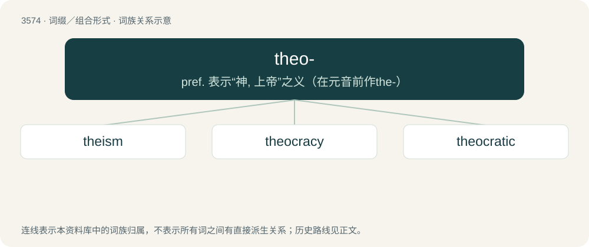

# 3644 · theo- — pref. 表示“神, 上帝”之义（在元音前作the-）

[总目录](../00_总目录_按常用程度.md)

**类型**：词缀／组合形式　｜　**来源语言**：见词源记录

## 核心含义与来源

- 核心含义：pref. 表示“神, 上帝”之义（在元音前作the-）
- 英文含义：god; deity
- 词形：theo-

**来源记录 1**（前缀／前置成分；god; deity）

From Latin theo- (“god”), combining form of theos (“god”); from Ancient Greek θεο- (theo-, “god”), combining form of θεός (theós, “god”).

## 词族图

## 单词速览（常用到不常用）

| 单词 | 音标 | 释义 |
|---|---|---|
| [theism](#w-1) | /ˈθiː.ɪz.əm/ | n. 有神论, 一神论, 茶中毒；\[医\] 茶中毒 |
| [theocracy](#w-2) | /θiːˈɒkɹəsi/ | n. 神权政治, 神权国 |
| [theocratic](#w-3) | /.θiːəˈkrætik/ | a. 神权政治的 |

## 逐词详解

### 1. theism

**词性**：名词　｜　**音标**：/ˈθiː.ɪz.əm/

**中文释义**：n. 有神论, 一神论, 茶中毒；\[医\] 茶中毒

**英文义项**：Belief in the existence of at least one deity. / Belief in the existence of a personal creator god, goddess, gods and/or goddesses present and active in the governance and organization of the world and the universe. The God may be known by or through revelation.

**构词拆分**：theo- + -ism

### 2. theocracy

**词性**：名词　｜　**音标**：/θiːˈɒkɹəsi/

**中文释义**：n. 神权政治, 神权国

**英文义项**：Government under the control of a state religion. / Rule by a god.

**构词拆分**：theo- + -cracy

**词源与演化**：

From theo- + -cracy, originally from Ancient Greek θεοκρατία (theokratía, “rule of (a) God”), a term coined in the 1st century by Josephus (Against Apion 2.17) in reference to the ancient Israelite polity under the Mosaic covenant. Attested in English from the 1620s, first by John Donne in A Sermon upon the fifth of November 1622. being the Anniversary celebration of our Deliverance from the Powder Treason: "The Jews were onely under a Theocratie, an immediate government of God..."

**例句**：

> The Vatican City State is a sovereign city-state and a Christian theocracy ruled by the Pope.

该用例对应义项：Government under the control of a state religion.

### 3. theocratic

**词性**：形容词　｜　**音标**：/.θiːəˈkrætik/

**中文释义**：a. 神权政治的

**英文义项**：Pertaining to theocracy. / Conforming to God-rule, by Christian behavior.

**构词拆分**：theocrat + -ic；theo- + -cratic

**词源与演化**：

From theocrat + -ic or theo- + -cratic.

**例句**：

> The U.S. Supreme Court is a tyranny of the extreme theocratic fascist minority.
