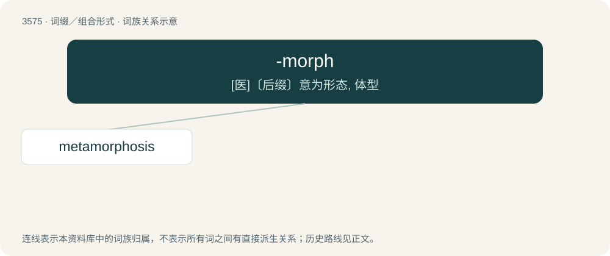

# 3645 · -morph — \[医\]〔后缀〕意为形态, 体型

[总目录](../00_总目录_按常用程度.md)

**类型**：词缀／组合形式　｜　**来源语言**：见词源记录

## 核心含义与来源

- 核心含义：\[医\]〔后缀〕意为形态, 体型
- 英文含义：shape, form, structure
- 词形：-morph

**来源记录 1**（后缀／后置成分；shape, form, structure）

Borrowed from Ancient Greek μορφή (morphḗ, “form, shape”).

## 词族图

## 单词速览（常用到不常用）

| 单词 | 音标 | 释义 |
|---|---|---|
| [metamorphosis](#w-1) | 英 /ˌmɛtəˈmɔːfəsɪs/；美 /ˌmɛtəˈmoɹfəsɪs/ | n. 蜕变, 变质, 变形；\[医\] 变态, 变形, 变质 |

## 逐词详解

### 1. metamorphosis

**词性**：名词　｜　**音标**：英 /ˌmɛtəˈmɔːfəsɪs/；美 /ˌmɛtəˈmoɹfəsɪs/

**中文释义**：n. 蜕变, 变质, 变形；\[医\] 变态, 变形, 变质

**英文义项**：A transformation, such as one performed by magic. / A noticeable change in character, appearance, function, or condition.

**构词拆分**：meta- + -morph + -osis

**词源与演化**：

First attested in 1533, from Latin metamorphōsis, from Ancient Greek μεταμόρφωσις (metamórphōsis), from μετά (metá, “change”) + μορφή (morphḗ, “form”). Analyzable as meta- + -morph + -osis

**例句**：

> The metamorphosis of the old house into something new and exciting.

该用例对应义项：a striking change in appearance or character or circumstances
