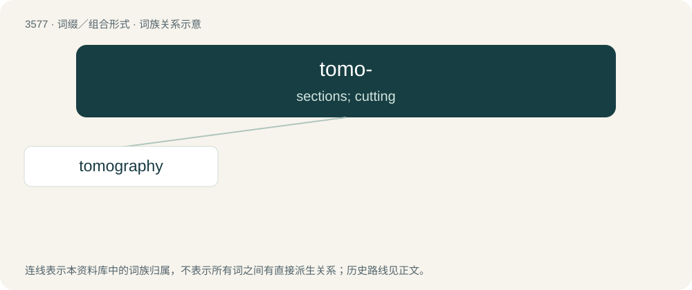

# 3647 · tomo- — sections; cutting

[总目录](../00_总目录_按常用程度.md)

**类型**：词缀／组合形式　｜　**来源语言**：见词源记录

## 核心含义与来源

- 核心含义：sections; cutting
- 英文含义：sections; cutting
- 词形：tomo-

**来源记录 1**（前缀／前置成分；sections; cutting）

Borrowed from Ancient Greek τόμος (tómos, “section, slice”), from τέμνω (témnō, “to cut”), ultimately from Proto-Indo-European \*temh₁- (“to cut”).

## 词族图

## 单词速览（常用到不常用）

| 单词 | 音标 | 释义 |
|---|---|---|
| [tomography](#w-1) | 英 /təˈmɒɡɹəfi/；美 /təˈmɑɡɹəfi/ | n. X线断层摄影术；\[医\] X线体层照相术, X线断层照相术 |

## 逐词详解

### 1. tomography

**词性**：名词　｜　**音标**：英 /təˈmɒɡɹəfi/；美 /təˈmɑɡɹəfi/

**中文释义**：n. X线断层摄影术；\[医\] X线体层照相术, X线断层照相术

**英文义项**：Imaging by (virtual) sections or sectioning.

**构词拆分**：tomo- + -graphy

**词源与演化**：

From tomo- + -graphy.

**例句**：

> MRI stands for Magnetic Resonance Imaging, whereas CT stands for Computed Tomography.
