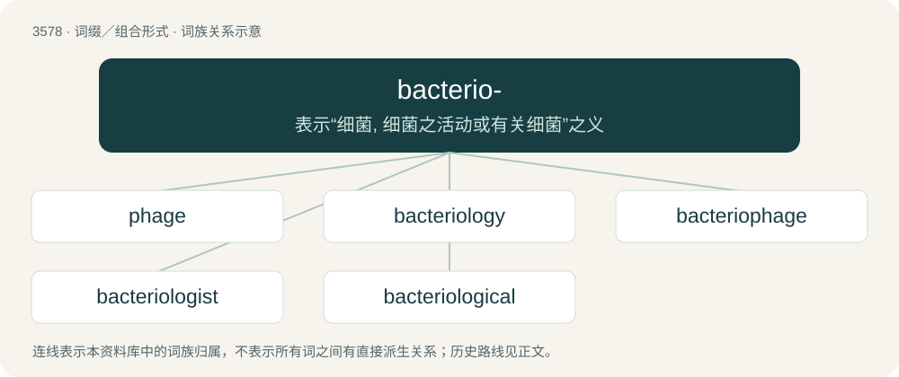

# 3648 · bacterio- — 表示“细菌, 细菌之活动或有关细菌”之义

[总目录](../00_总目录_按常用程度.md)

**类型**：词缀／组合形式　｜　**来源语言**：见词源记录

## 核心含义与来源

- 核心含义：表示“细菌, 细菌之活动或有关细菌”之义
- 英文含义：bacteria
- 词形：bacterio-

**来源记录 1**（前缀／前置成分；bacteria）

From New Latin bactērium + English -o-.

## 词族图

## 单词速览（常用到不常用）

| 单词 | 音标 | 释义 |
|---|---|---|
| [phage](#w-1) | /feɪd͡ʒ/ | n. 噬菌体；\[化\] 噬菌体 |
| [bacteriology](#w-2) | /bækˌtɪəɹ.ɪˈɒləd͡ʒi/ | n. 细菌学 |
| [bacteriophage](#w-3) | /bækˈtɪəɹ.ɪəʊˌfeɪd͡ʒ/ | n. 噬菌体；\[医\] 噬菌体 |
| [bacteriologist](#w-4) | /bækˌtɪəɹiˈɒlədʒɪst/ | n. 细菌学家；\[医\] 细菌学 |
| [bacteriological](#w-5) | /bæk,tiəriəˈlɔdʒikəl/ | a. 细菌学的, 细菌学上的；\[医\] 细菌学家, 细菌学者 |

## 逐词详解

### 1. phage

**词性**：名词　｜　**音标**：/feɪd͡ʒ/

**中文释义**：n. 噬菌体；\[化\] 噬菌体

**英文义项**：A virus that is parasitic on bacteria.

**构词拆分**：bacterio- (“bacteria”) + -phage (“eater”)

**词源与演化**：

Clipping of bacteriophage from bacterio- (“bacteria”) + -phage (“eater”); latter suffix from Ancient Greek -φάγος (-phágos, “eater”), from φαγ- (phag-), aorist stem of ἐσθίω (esthíō) or ἔδω (édō, “to eat, to consume”). Stem φαγ- (phag-) may also derive from Proto-Indo-European \*bʰeh₂g- (“to divide, distribute”) thus ultimately doublet of bhakti (via Sanskrit भक्ति (bhakti, “portion, division”) from root भज् (bhaj, “to divide, to apportion”)).

**例句**：

> Phage uses the bacterium's machinery and energy to produce more phage until the bacterium is destroyed and phage is released to invade surrounding bacteria.

该用例对应义项：a virus that is parasitic (reproduces itself) in bacteria

### 2. bacteriology

**词性**：名词　｜　**音标**：/bækˌtɪəɹ.ɪˈɒləd͡ʒi/

**中文释义**：n. 细菌学

**英文义项**：The scientific study of bacteria, especially in relation to disease and agriculture.

**构词拆分**：bacterio- + -logy

**词源与演化**：

From bacterio- + -logy.

### 3. bacteriophage

**词性**：名词　｜　**音标**：/bækˈtɪəɹ.ɪəʊˌfeɪd͡ʒ/

**中文释义**：n. 噬菌体；\[医\] 噬菌体

**英文义项**：A virus that specifically infects bacteria.

**构词拆分**：bacterio- (“bacteria”) + -phage (“eater”)

**词源与演化**：

Borrowed from French bactériophage, coined by microbiologist Félix d'Hérelle, from bacterio- (“bacteria”) + -phage (“eater”).

### 4. bacteriologist

**词性**：名词　｜　**音标**：/bækˌtɪəɹiˈɒlədʒɪst/

**中文释义**：n. 细菌学家；\[医\] 细菌学

**英文义项**：A microbiologist whose speciality is bacteriology.

**构词拆分**：bacterio- + -logist

**词源与演化**：

From bacterio- + -logist.

### 5. bacteriological

**词性**：形容词　｜　**音标**：/bæk,tiəriəˈlɔdʒikəl/

**中文释义**：a. 细菌学的, 细菌学上的；\[医\] 细菌学家, 细菌学者

**英文义项**：Of or pertaining to bacteriology.

**构词拆分**：bacterio- + -logical

**词源与演化**：

From bacterio- + -logical.
