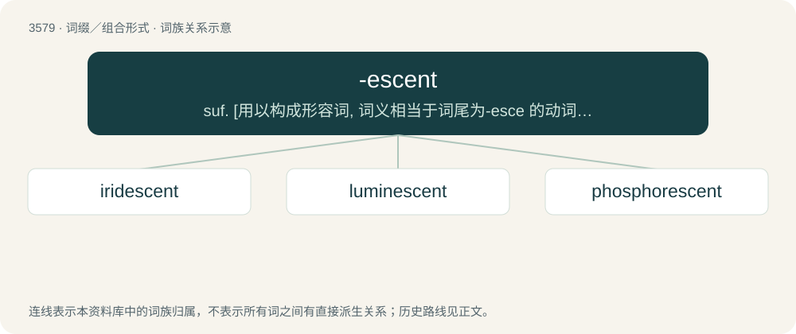

# 3649 · -escent — suf. \[用以构成形容词, 词义相当于词尾为-esce 的动词和以-escence 结尾的名词\]表示：“在…过程中”, “开始发生”, “开始成为”,“发光的”, “反光的”

[总目录](../00_总目录_按常用程度.md)

**类型**：词缀／组合形式　｜　**来源语言**：见词源记录

## 核心含义与来源

- 核心含义：suf. \[用以构成形容词, 词义相当于词尾为-esce 的动词和以-escence 结尾的名词\]表示：“在…过程中”, “开始发生”, “开始成为”,“发光的”, “反光的”
- 英文含义：beginning to be; becoming
- 词形：-escent

**来源记录 1**（后缀／后置成分；beginning to be; becoming）

From Latin -ēscēns, present participle of -ēscō (“I become”). By surface analysis, -esce + -ent.

## 词族图

## 单词速览（常用到不常用）

| 单词 | 音标 | 释义 |
|---|---|---|
| [iridescent](#w-1) | /ˌɪɹ.ɪˈdɛs.ənt/ | a. 彩虹色的, 闪光的；\[医\] 虹色的, 晕色的 |
| [luminescent](#w-2) | /luːmɪˈnɛs(ə)nt/ | a. 发冷光的, 发光的；\[电\] 发光的 |
| [phosphorescent](#w-3) | /.fɒsfəˈresnt/ | a. 发出磷光的, 闪磷火的, 磷光性的；\[医\] 磷光的 |

## 逐词详解

### 1. iridescent

**词性**：形容词　｜　**音标**：/ˌɪɹ.ɪˈdɛs.ənt/

**中文释义**：a. 彩虹色的, 闪光的；\[医\] 虹色的, 晕色的

**英文义项**：Producing a display of lustrous, rainbow-like colors; prismatic. / Brilliant, lustrous, or colorful.

**构词拆分**：Latin iris, iridis (“rainbow”) + -escent

**词源与演化**：

Coined around 1800, from Latin iris, iridis (“rainbow”) + -escent.

**用法示例／搭配（非完整句）**：

> iridescent appearance

该用例对应义项：Producing a display of lustrous, rainbow-like colors; prismatic.

### 2. luminescent

**词性**：形容词　｜　**音标**：/luːmɪˈnɛs(ə)nt/

**中文释义**：a. 发冷光的, 发光的；\[电\] 发光的

**英文义项**：Emitting light by luminescence.

**构词拆分**：luminesce + -ent

**词源与演化**：

From stem of Latin lumen (“light”) + -escent, equivalent to luminesce + -ent.

### 3. phosphorescent

**词性**：形容词　｜　**音标**：/.fɒsfəˈresnt/

**中文释义**：a. 发出磷光的, 闪磷火的, 磷光性的；\[医\] 磷光的

**英文义项**：Having the property of emitting light for a period of time after the source of excitation is taken away, e.g., in electrostatic storage tubes and cathode-ray tubes.

**构词拆分**：phosphorus + -escent

**词源与演化**：

From phosphorus + -escent. It's interesting to note that phosphorus is not phosphorescent. Some phosphoric mixtures can be luminescent through chemical reactions, but none exhibit literal phosphorescence.

**例句**：

> The phosphorescent glow of decaying wood.

该用例对应义项：emitting light without appreciable heat as by slow oxidation of phosphorous
