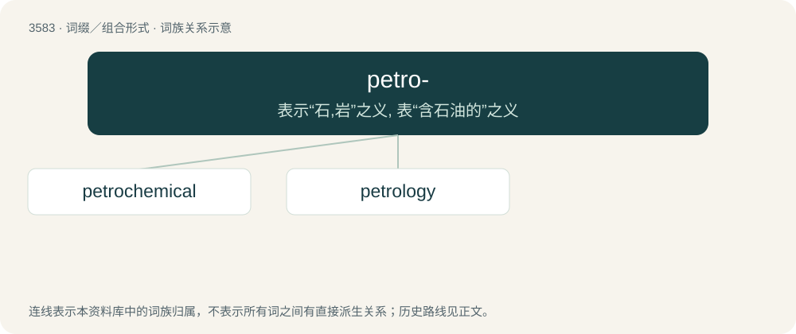

# 3651 · petro- — 表示“石,岩”之义, 表“含石油的”之义

[总目录](../00_总目录_按常用程度.md)

**类型**：词缀／组合形式　｜　**来源语言**：见词源记录

## 核心含义与来源

- 核心含义：表示“石,岩”之义, 表“含石油的”之义
- 英文含义：stone
- 词形：petro-

## 词族图

## 单词速览（常用到不常用）

| 单词 | 音标 | 释义 |
|---|---|---|
| [petrochemical](#w-1) | /.petrəuˈkemikəl/ | a. 石化的, 石化制品的, 岩石化学的；n. 石化产品 |
| [petrology](#w-2) | 英 /pɪˈtɹɒl.ə.d͡ʒi/；美 /pəˈtɹɑl.ə.d͡ʒi/ | n. 岩石学 |

## 逐词详解

### 1. petrochemical

**词性**：名词　｜　**音标**：/.petrəuˈkemikəl/

**中文释义**：a. 石化的, 石化制品的, 岩石化学的；n. 石化产品

**英文义项**：Any chemical derived from petroleum. / Any chemical derived from any of the fossil fuels: petroleum, natural gas, or coal.

**构词拆分**：petro- + chemical

**词源与演化**：

From petro- + chemical.

**例句**：

> As the prices of petroleum, natural gas, and coal fluctuate over the years, the petrochemical industry can to some extent switch feedstocks.

该用例对应义项：Any chemical derived from any of the fossil fuels: petroleum, natural gas, or coal.

### 2. petrology

**词性**：名词　｜　**音标**：英 /pɪˈtɹɒl.ə.d͡ʒi/；美 /pəˈtɹɑl.ə.d͡ʒi/

**中文释义**：n. 岩石学

**英文义项**：The study of the origin, composition and structure of rock.

**构词拆分**：petro- + -logy

**词源与演化**：

From petro- + -logy.

**例句**：

> Geology is divided into various branches such as mineralogy, petrology, and physical geology.
