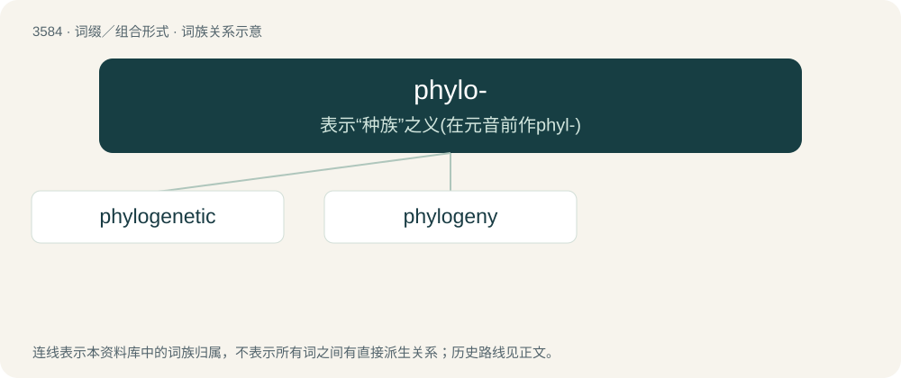

# 3653 · phylo- — 表示“种族”之义(在元音前作phyl-)

[总目录](../00_总目录_按常用程度.md)

**类型**：词缀／组合形式　｜　**来源语言**：见词源记录

## 核心含义与来源

- 核心含义：表示“种族”之义(在元音前作phyl-)
- 英文含义：tribes, races or phyla
- 词形：phylo-

**来源记录 1**（前缀／前置成分；tribes, races or phyla）

From Ancient Greek φῦλον (phûlon, “tribe, genus, species”).

## 词族图

## 单词速览（常用到不常用）

| 单词 | 音标 | 释义 |
|---|---|---|
| [phylogenetic](#w-1) | 美 /ˌfaɪ.loʊ.d͡ʒəˈnɛt.ɪk/ | a. 种系发生的, 系统发育的；\[医\] 种系发生的, 种族发育的 |
| [phylogeny](#w-2) | 英 /faɪˈlɒd͡ʒəni/；美 /faɪˈlɑd͡ʒəni/ | n. 种系发生, 发展史, 语系发生；\[医\] 种系发生, 种族发育 |

## 逐词详解

### 1. phylogenetic

**词性**：形容词　｜　**音标**：美 /ˌfaɪ.loʊ.d͡ʒəˈnɛt.ɪk/

**中文释义**：a. 种系发生的, 系统发育的；\[医\] 种系发生的, 种族发育的

**英文义项**：Of, or relating to phylogeny or phylogenetics.

**构词拆分**：phylo- + genetic

**词源与演化**：

From phylo- + genetic, from German phylogenetisch, coined by Ernst Haeckel in 1866, from Phylogenese + -isch.

**例句**：

> Man returns to his phylogenetic roots in panic situations.

### 2. phylogeny

**词性**：名词　｜　**音标**：英 /faɪˈlɒd͡ʒəni/；美 /faɪˈlɑd͡ʒəni/

**中文释义**：n. 种系发生, 发展史, 语系发生；\[医\] 种系发生, 种族发育

**英文义项**：The evolutionary history of groups of organisms, such as species or clades. / A phylogenetic diagram.

**构词拆分**：phylo- + -geny

**词源与演化**：

Borrowed from German Phylogenie, coined by Ernst Haeckel in 1866, a neologism created as if borrowed from a Classic Greek word φυλογένεια (phulogéneia), composed from Ancient Greek φῦλον (phûlon, “tribe, genus, species”) + -γένεια (-géneia, “-geny (generation, production)”), equivalent to phylo- + -geny.

**例句**：

> Understanding the phylogeny of this musical group helps us understand its music.

该用例对应义项：The historical development of a human social or racial group.
