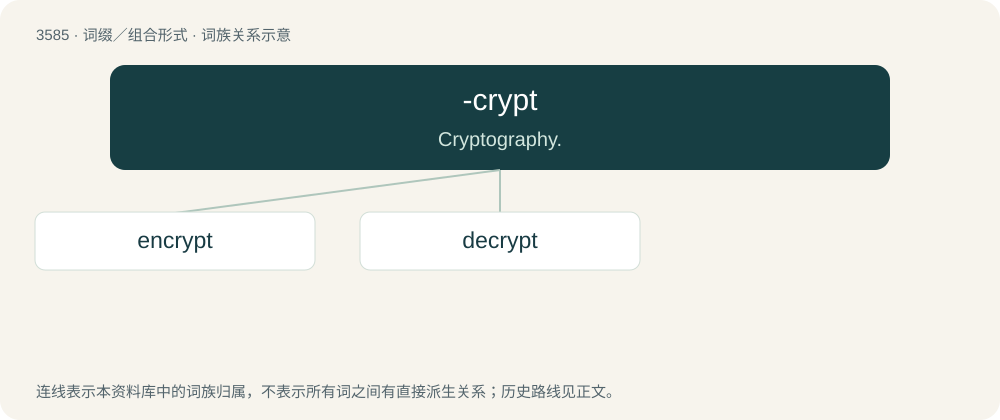

# 3654 · -crypt — Cryptography.

[总目录](../00_总目录_按常用程度.md)

**类型**：词缀／组合形式　｜　**来源语言**：见词源记录

## 核心含义与来源

- 核心含义：Cryptography.
- 英文含义：Cryptography.
- 词形：-crypt

**来源记录 1**（后缀／后置成分；Cryptography.）

From Ancient Greek κρυπτός (kruptós, literally “hidden, concealed, private, secret”).

## 词族图

## 单词速览（常用到不常用）

| 单词 | 音标 | 释义 |
|---|---|---|
| [encrypt](#w-1) | /ɪnˈkɹɪpt/ | \[计\] 加密 |
| [decrypt](#w-2) | /dɪˈkɹɪpt/ | vt. 解...的密码；\[计\] 解密, 译码 |

## 逐词详解

### 1. encrypt

**词性**：动词　｜　**音标**：/ɪnˈkɹɪpt/

**中文释义**：\[计\] 加密

**英文义项**：To conceal information by means of a code or cipher. / To transform information using encryption in a way that it is believed only authorized parties can decode.

**构词拆分**：en- + -crypt

**词源与演化**：

From en- + -crypt, from Ancient Greek κρυπτός (kruptós, literally “hidden, concealed, private, secret”).

**例句**：

> All messages on this platform are doubly encrypted to increase security.

该用例对应义项：To conceal information by means of a code or cipher.

### 2. decrypt

**词性**：动词　｜　**音标**：/dɪˈkɹɪpt/

**中文释义**：vt. 解...的密码；\[计\] 解密, 译码

**英文义项**：To convert (an encrypted or coded message) back into plain text.

**构词拆分**：de- + -crypt

**词源与演化**：

From de- + -crypt, from Ancient Greek κρυπτός (kruptós, literally “hidden, concealed, private, secret”).

**例句**：

> Once I decrypt this email, we'll have all the information that we'll need.
