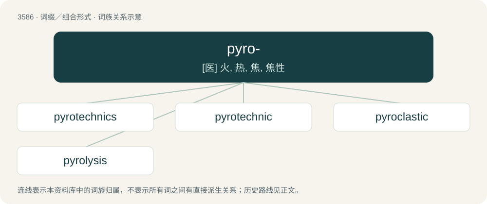

# 3656 · pyro- — \[医\] 火, 热, 焦, 焦性

[总目录](../00_总目录_按常用程度.md)

**类型**：词缀／组合形式　｜　**来源语言**：见词源记录

## 核心含义与来源

- 核心含义：\[医\] 火, 热, 焦, 焦性
- 英文含义：Fire, heat.
- 词形：pyro-

**来源记录 1**（前缀／前置成分；Fire, heat.）

From Latin pyr, from Ancient Greek πῦρ (pûr, “fire”).

## 词族图

## 单词速览（常用到不常用）

| 单词 | 音标 | 释义 |
|---|---|---|
| [pyrotechnics](#w-1) | 美 /ˌpaɪ.roʊˈtɛk.nɪks/；/ˌpaɪ.ɹəˈtɛk.nəks/ | n. 烟火制造术, 烟火使用 |
| [pyrotechnic](#w-2) | 美 /ˌpaɪɹoʊˈtɛknɪk/ | a. 烟火的, 令人眼花缭乱的, 夸大炫耀的 |
| [pyroclastic](#w-3) | /,paiərə?ˈklæstik,,pi-/ | a. 火成碎屑的；n. 火成碎屑物 |
| [pyrolysis](#w-4) | 英 /paɪˈɹɒlɪsɪs/；美 /paɪˈɹɑləsɪs/ | n. 高温分解；\[化\] 热解; 裂解 |

## 逐词详解

### 1. pyrotechnics

**词性**：名词　｜　**音标**：美 /ˌpaɪ.roʊˈtɛk.nɪks/；/ˌpaɪ.ɹəˈtɛk.nəks/

**中文释义**：n. 烟火制造术, 烟火使用

**英文义项**：The art and technology of fireworks and related military applications. / A display of fireworks.

**构词拆分**：pyro- + technic + -ics

**词源与演化**：

From pyro- + technic + -ics.

**例句**：

> The pyrotechnics have started this night, several hours before the Halloween of 2021.

### 2. pyrotechnic

**词性**：形容词　｜　**音标**：美 /ˌpaɪɹoʊˈtɛknɪk/

**中文释义**：a. 烟火的, 令人眼花缭乱的, 夸大炫耀的

**英文义项**：Of or relating to fireworks. / Of or relating to the use of fire in chemistry or metallurgy.

**构词拆分**：pyro- + technic

**词源与演化**：

From Latin pyrotechnica, from Ancient Greek πῦρ (pûr, “fire”) + τεχνικός (tekhnikós, “skillful, workmanlike”). Analyzable as pyro- + technic.

**例句**：

> They were about to start the pyrotechnic show.

### 3. pyroclastic

**词性**：形容词　｜　**音标**：/,paiərə?ˈklæstik,,pi-/

**中文释义**：a. 火成碎屑的；n. 火成碎屑物

**英文义项**：Mostly composed of rock fragments of volcanic origin or comminuted during an eruption.

**词源与演化**：

From pyro- + clastic, from Ancient Greek πῦρ (pûr, “fire”), and κλαστός (klastós, “broken”).

### 4. pyrolysis

**词性**：名词　｜　**音标**：英 /paɪˈɹɒlɪsɪs/；美 /paɪˈɹɑləsɪs/

**中文释义**：n. 高温分解；\[化\] 热解; 裂解

**英文义项**：The decomposition of a material or compound by heat, in the absence of oxygen or other reagents.

**构词拆分**：pyro- + -lysis

**词源与演化**：

From pyro- + -lysis.
