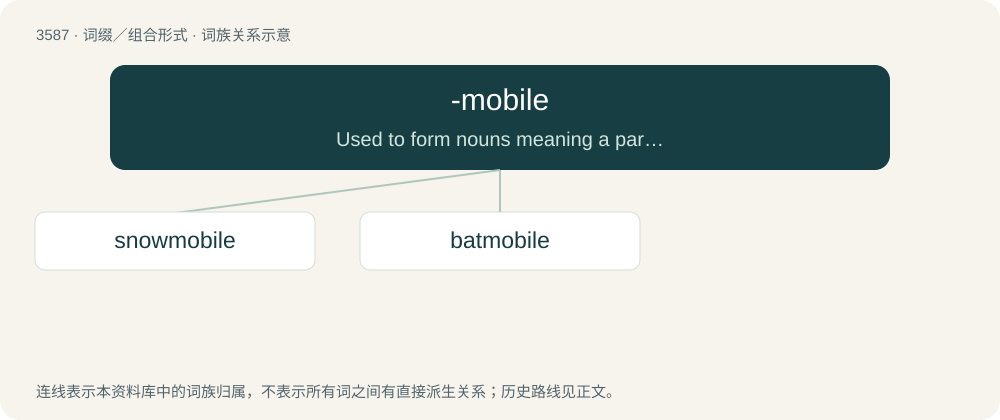

# 3657 · -mobile — Used to form nouns meaning a particular type of vehicle, particularly one to transport the person or thing described by the word to which the suffix is attached.

[总目录](../00_总目录_按常用程度.md)

**类型**：词缀／组合形式　｜　**来源语言**：见词源记录

## 核心含义与来源

- 核心含义：Used to form nouns meaning a particular type of vehicle, particularly one to transport the person or thing described by the word to which the suffix is attached.
- 英文含义：Used to form nouns meaning a particular type of vehicle, particularly one to transport the person or thing described by the word to which the suffix is attached.
- 词形：-mobile

**来源记录 1**（后缀／后置成分；Used to form nouns meaning a particular type of vehicle, particularly one to transport the person or thing described by the word to which the suffix is attached.）

Back-formation from automobile.

## 词族图

## 单词速览（常用到不常用）

| 单词 | 音标 | 释义 |
|---|---|---|
| [snowmobile](#w-1) | /ˈsnəuməubiːl/ | n. 雪上机动车 |
| [batmobile](#w-2) |  | 蝙蝠车 |

## 逐词详解

### 1. snowmobile

**词性**：名词　｜　**音标**：/ˈsnəuməubiːl/

**中文释义**：n. 雪上机动车

**英文义项**：A vehicle with skis at the front and a caterpillar track at the rear, used for travelling over snow, sometimes as sport.

**构词拆分**：snow + -mobile

**词源与演化**：

From snow + -mobile.

**例句**：

> Get his glove off carefully. He's smashed his fingers between the snowmobile and a tree.

### 2. batmobile

**词性**：动词

**中文释义**：蝙蝠车

**英文义项**：To move or proceed as if in the Batmobile / To put up an emotional or intellectual shield, especially to protect oneself from something that makes one uncomfortable.

**构词拆分**：bat + -mobile

**词源与演化**：

From the Batmobile driven by superhero Batman in the eponymous media franchise, from bat + -mobile. The second verb sense references the retractable shielding featured on the vehicle in the 1989 film.

**例句**：

> Now where did I park the batmobile?
