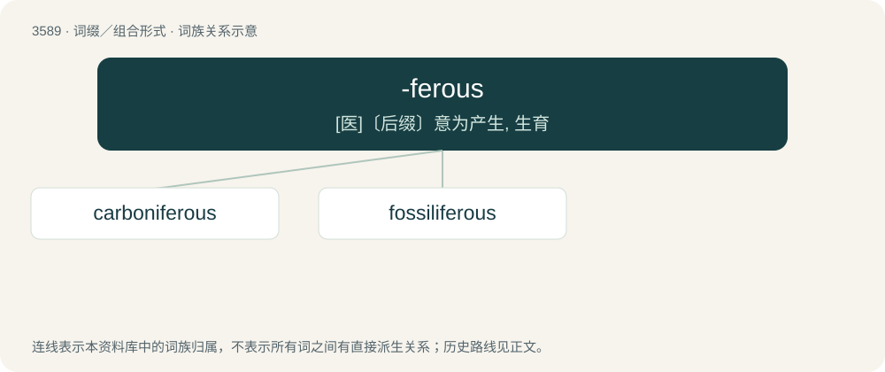

# 3658 · -ferous — \[医\]〔后缀〕意为产生, 生育

[总目录](../00_总目录_按常用程度.md)

**类型**：词缀／组合形式　｜　**来源语言**：见词源记录

## 核心含义与来源

- 核心含义：\[医\]〔后缀〕意为产生, 生育
- 英文含义：Used to form adjectives from nouns, with the sense “bearing an entity or entities as specified by the noun”.
- 词形：-ferous

**来源记录 1**（后缀／后置成分；Used to form adjectives from nouns, with the sense “bearing an entity or entities as specified by the noun”.）

From Latin ferō (“to bear”) + English -ous.

## 词族图

## 单词速览（常用到不常用）

| 单词 | 音标 | 释义 |
|---|---|---|
| [carboniferous](#w-1) | 英 /ˌkɑːbəˈnɪfəɹəs/ | 【英文】Containing or producing carbon. |
| [fossiliferous](#w-2) | /.fɒsiˈlifərəs/ | a. 含有化石的 |

## 逐词详解

### 1. carboniferous

**词性**：形容词　｜　**音标**：英 /ˌkɑːbəˈnɪfəɹəs/

**英文义项**：Containing or producing carbon.

**构词拆分**：carbon + -i- + -ferous

**词源与演化**：

From carbon + -i- + -ferous.

### 2. fossiliferous

**词性**：形容词　｜　**音标**：/.fɒsiˈlifərəs/

**中文释义**：a. 含有化石的

**英文义项**：Containing fossils.

**构词拆分**：fossil + -i- + -ferous

**词源与演化**：

From fossil + -i- + -ferous.
