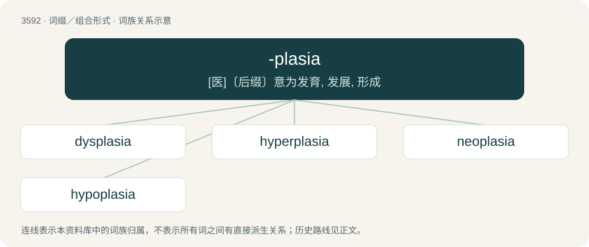

# 3661 · -plasia — \[医\]〔后缀〕意为发育, 发展, 形成

[总目录](../00_总目录_按常用程度.md)

**类型**：词缀／组合形式　｜　**来源语言**：见词源记录

## 核心含义与来源

- 核心含义：\[医\]〔后缀〕意为发育, 发展, 形成
- 英文含义：Growth or formation
- 词形：-plasia

**来源记录 1**（后缀／后置成分；Growth or formation）

From New Latin -plasia, from Ancient Greek πλάσις (plásis, “molding, formation”).

## 词族图

## 单词速览（常用到不常用）

| 单词 | 音标 | 释义 |
|---|---|---|
| [dysplasia](#w-1) | /dɪsˈpleɪ.ʒə/ | n. 发育异常, 发育不良；\[医\] 发育异常, 发育不良 |
| [hyperplasia](#w-2) | /ˌhaɪ.pɚˈpleɪ.ʒə/ | n. 增生, 增殖；\[医\] 增生 |
| [neoplasia](#w-3) | /ˈni(ː)əuˈpleizʒə, -ʒiə/ | n. 瘤形成；\[医\] 瘤形成 |
| [hypoplasia](#w-4) | /,haipəuˈpleizjə/ | n. 发育不全；\[医\] 发育不全 |

## 逐词详解

### 1. dysplasia

**词性**：名词　｜　**音标**：/dɪsˈpleɪ.ʒə/

**中文释义**：n. 发育异常, 发育不良；\[医\] 发育异常, 发育不良

**英文义项**：Abnormal development of cells or tissue, often a precancerous stage of growth. / The trauma caused by asynchronous psychological development on children.

**构词拆分**：dys- + -plasia

**词源与演化**：

\* From dys- + -plasia. \* (psychology): Introduced by John Curtis Gowan in 1974.

### 2. hyperplasia

**词性**：名词　｜　**音标**：/ˌhaɪ.pɚˈpleɪ.ʒə/

**中文释义**：n. 增生, 增殖；\[医\] 增生

**英文义项**：An increase in the size of a tissue or organ due to increased number of cells.

**构词拆分**：hyper- + -plasia

**词源与演化**：

From hyper- + -plasia.

### 3. neoplasia

**词性**：名词　｜　**音标**：/ˈni(ː)əuˈpleizʒə, -ʒiə/

**中文释义**：n. 瘤形成；\[医\] 瘤形成

**英文义项**：The formation of new tissue / The formation of a neoplasm

**构词拆分**：neo- + -plasia

**词源与演化**：

From neo- + -plasia.

### 4. hypoplasia

**词性**：名词　｜　**音标**：/,haipəuˈpleizjə/

**中文释义**：n. 发育不全；\[医\] 发育不全

**英文义项**：Underdevelopment or incomplete development of a tissue or organ, especially when caused by an inadequate or below-normal number of cells.

**构词拆分**：hypo- + -plasia

**词源与演化**：

From hypo- + -plasia.
