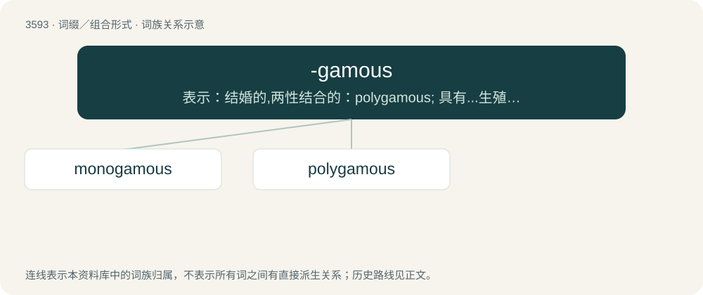

# 3662 · -gamous — 表示：结婚的,两性结合的：polygamous; 具有...生殖器官的：heterogamous

[总目录](../00_总目录_按常用程度.md)

**类型**：词缀／组合形式　｜　**来源语言**：见词源记录

## 核心含义与来源

- 核心含义：表示：结婚的,两性结合的：polygamous; 具有...生殖器官的：heterogamous
- 英文含义：Having the specified number or form of marriage.
- 词形：-gamous

**来源记录 1**（后缀／后置成分；Having the specified number or form of marriage.）

From Ancient Greek γάμος (gámos, “union, marriage”), equivalent to -gamy + -ous.

## 词族图

## 单词速览（常用到不常用）

| 单词 | 音标 | 释义 |
|---|---|---|
| [monogamous](#w-1) | 英 /məˈnɒɡəməs/；美 /məˈnɑɡəməs/ | a. 一夫一妻制的 |
| [polygamous](#w-2) | /pəˈlɪɡəməs/ | a. 多配偶(制)的, 多偶性的；\[医\] 多配\[合\]的 |

## 逐词详解

### 1. monogamous

**词性**：形容词　｜　**音标**：英 /məˈnɒɡəməs/；美 /məˈnɑɡəməs/

**中文释义**：a. 一夫一妻制的

**英文义项**：Involving marriage to one person at a time. / Characterized by mutual sexual and romantic exclusivity.

**构词拆分**：mono- + -gamous

**词源与演化**：

From mono- + -gamous.

**例句**：

> Unlike most other rodents, beaver pairs are monogamous, staying together for multiple breeding seasons.

### 2. polygamous

**词性**：形容词　｜　**音标**：/pəˈlɪɡəməs/

**中文释义**：a. 多配偶(制)的, 多偶性的；\[医\] 多配\[合\]的

**英文义项**：Of, relating to, or practicing polygamy. / Exhibiting polygamy.

**构词拆分**：poly- + -gamous

**词源与演化**：

From poly- + -gamous.

**例句**：

> That Mormon community no longer practises polygamous relationships.

该用例对应义项：Of, relating to, or practicing polygamy.
