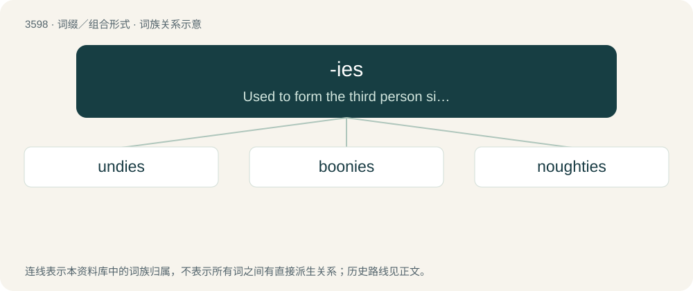

# 3665 · -ies — Used to form the third person singular in the present indicative of verbs ending in a consonant + y.

[总目录](../00_总目录_按常用程度.md)

**类型**：词缀／组合形式　｜　**来源语言**：见词源记录

## 核心含义与来源

- 核心含义：Used to form the third person singular in the present indicative of verbs ending in a consonant + y.
- 英文含义：Used to form the third person singular in the present indicative of verbs ending in a consonant + y.
- 词形：-ies

## 词族图

## 单词速览（常用到不常用）

| 单词 | 音标 | 释义 |
|---|---|---|
| [undies](#w-1) | /ˈʌn.dis/ | n. 内衣 |
| [boonies](#w-2) | /ˈbuːniz/ | \[俚\]郊区, 远离城市的原野 |
| [noughties](#w-3) | 英 /ˈnɔːtiz/ | n. 21 世纪头十年（即从 2000 年到 2009 年的十年） |

## 逐词详解

### 1. undies

**词性**：名词　｜　**音标**：/ˈʌn.dis/

**中文释义**：n. 内衣

**英文义项**：underwear, underpants

**词源与演化**：

und(erwear) + -ies.

### 2. boonies

**词性**：名词　｜　**音标**：/ˈbuːniz/

**中文释义**：\[俚\]郊区, 远离城市的原野

**英文义项**：Boondocks.

**词源与演化**：

Clipping of boondocks + -ies, as if a singular \*boony (“remote place (singular)”). It was shortened as such by 1964 originally among U.S. troops serving in the Vietnam War in reference to the rural areas of Vietnam, as opposed to Saigon.

**例句**：

> I couldn't stand living out in the boonies, so I moved to the Big Apple.

### 3. noughties

**词性**：名词　｜　**音标**：英 /ˈnɔːtiz/

**中文释义**：n. 21 世纪头十年（即从 2000 年到 2009 年的十年）

**英文义项**：The decade consisting of the last year of the previous century and the first nine years of the next: from 1900 to 1909, 2000 to 2009, etc.

**构词拆分**：nought (“zero”) + -ies (“plural of -y”)

**词源与演化**：

From nought (“zero”) + -ies (“plural of -y”), in imitation of the names of other decades (twenties, thirties, etc).

**例句**：

> Generation Z includes those born in the early noughties, which is the first decade of the 21st Century from 2000 to 2009.
