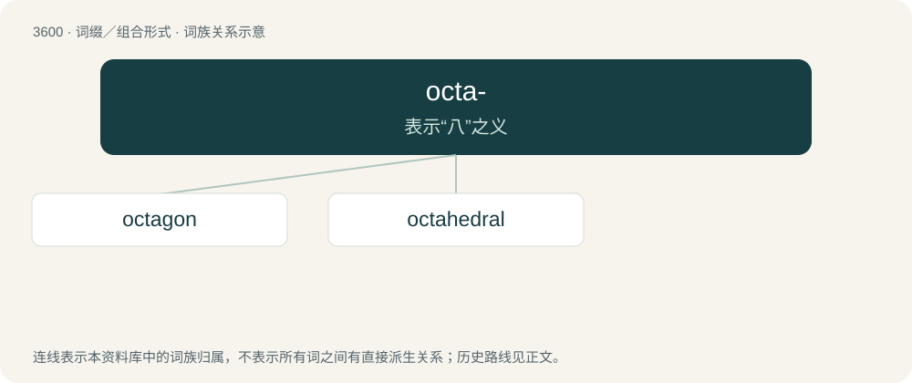

# 3668 · octa- — 表示“八”之义

[总目录](../00_总目录_按常用程度.md)

**类型**：词缀／组合形式　｜　**来源语言**：见词源记录

## 核心含义与来源

- 核心含义：表示“八”之义
- 英文含义：Eight.
- 词形：octa-

**来源记录 1**（前缀／前置成分；Eight.）

From Ancient Greek ὀκτα- (okta-, “eight”); compare ὀκτώ (oktṓ).

## 词族图

## 单词速览（常用到不常用）

| 单词 | 音标 | 释义 |
|---|---|---|
| [octagon](#w-1) | 英 /ˈɒktəɡ(ə)n/；美 /ˈɑktəˌɡɑn/ | n. 八边形, 八角形 |
| [octahedral](#w-2) | /.ɒktəˈhiːdrəl/ | a. 八面的, 八面体的 |

## 逐词详解

### 1. octagon

**词性**：名词　｜　**音标**：英 /ˈɒktəɡ(ə)n/；美 /ˈɑktəˌɡɑn/

**中文释义**：n. 八边形, 八角形

**英文义项**：A polygon with eight sides and eight angles. / An arena for mixed martial arts.

**构词拆分**：octa- + -gon

**词源与演化**：

From Latin octagōnon, octōgōnon (“octagon”), and from its etymon Ancient Greek ὀκτάγωνον (oktágōnon, “octagon”), probably from Koine Greek ὀκτάγωνος (oktágōnos, “having eight corners”) + -ον (-on, suffix forming nouns). ὀκτάγωνος is derived from ὀκτᾰ- (oktă-, prefix meaning ‘eight’) (from ὀκτώ (oktṓ, “eight”), ultimately from Proto-Indo-European \*oḱtṓw (“eight”)) + γωνία (gōnía, “angle; corner”) (probably ultimately from Proto-Indo-European \*ǵónu (“knee”)); analysable as octa- + -gon. The English word is cognate with Middle French octogone (modern French octogone), Italian octagono (obsolete), ottagono, Spanish octágono, octógono. Sense 2 (“arena for mixed martial arts”) refers to its shape.

**例句**：

> The internal angles of an octagon total 1080°.

### 2. octahedral

**词性**：形容词　｜　**音标**：/.ɒktəˈhiːdrəl/

**中文释义**：a. 八面的, 八面体的

**英文义项**：Of, relating to, or having the shape of an octahedron.

**构词拆分**：octa- + -hedral

**词源与演化**：

From octa- + -hedral.
