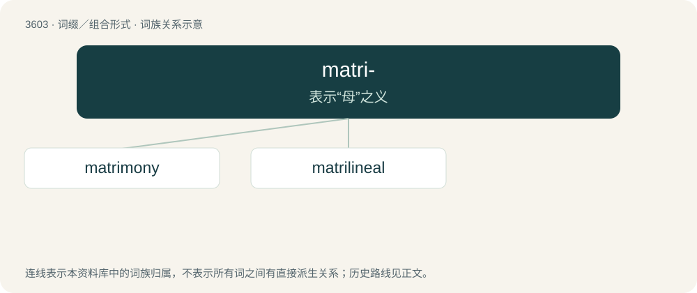

# 3669 · matri- — 表示“母”之义

[总目录](../00_总目录_按常用程度.md)

**类型**：词缀／组合形式　｜　**来源语言**：见词源记录

## 核心含义与来源

- 核心含义：表示“母”之义
- 英文含义：mother
- 词形：matri-

**来源记录 1**（前缀／前置成分；mother）

From Latin māter.

## 词族图

## 单词速览（常用到不常用）

| 单词 | 音标 | 释义 |
|---|---|---|
| [matrimony](#w-1) | 英 /ˈmat.ɹɪ.mə.ni/；美 /ˈmæt.ɹɪˌmoʊ.ni/ | n. 结婚, 婚姻生活, 婚礼；\[法\] 婚姻, 结婚, 婚礼 |
| [matrilineal](#w-2) | /ˌmeɪtɹɪˈlɪnɪəl/ | a. 母系的；\[医\] 母系的 |

## 逐词详解

### 1. matrimony

**词性**：名词　｜　**音标**：英 /ˈmat.ɹɪ.mə.ni/；美 /ˈmæt.ɹɪˌmoʊ.ni/

**中文释义**：n. 结婚, 婚姻生活, 婚礼；\[法\] 婚姻, 结婚, 婚礼

**英文义项**：Marriage; the state of being married. / The ceremony of marriage.

**构词拆分**：By surface analysis, matri- + -mony

**词源与演化**：

From Old French matremoine, from Latin mātrimōnium (“marriage, wedlock”), from mātri(s) (“mother”) + -mōnium (“obligation”). By surface analysis, matri- + -mony. Compare patrimony.

**例句**：

> Matrimony is the attempt of a couple to solve problems they would never have had as singles.

### 2. matrilineal

**词性**：形容词　｜　**音标**：/ˌmeɪtɹɪˈlɪnɪəl/

**中文释义**：a. 母系的；\[医\] 母系的

**英文义项**：Tracing descent only through female ancestors.

**构词拆分**：matri- + lineal

**词源与演化**：

From matri- + lineal. Coined by British government anthropologist Northcote Whitridge Thomas in 1904 along with patrilineal.

**例句**：

> Kerala traditionally has matrilineal inheritance.

该用例对应义项：Tracing descent only through female ancestors.
