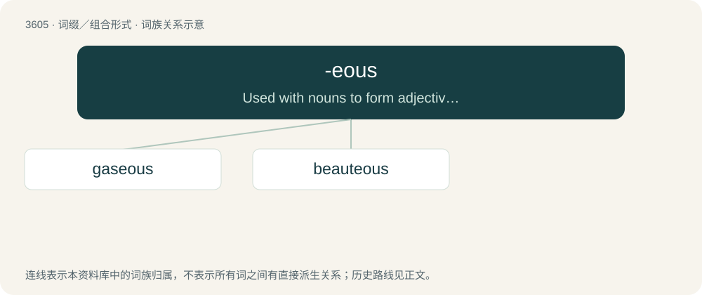

# 3672 · -eous — Used with nouns to form adjectives with the sense of resembling or having the characteristics of the suffixed term; similar to -ous.

[总目录](../00_总目录_按常用程度.md)

**类型**：词缀／组合形式　｜　**来源语言**：见词源记录

## 核心含义与来源

- 核心含义：Used with nouns to form adjectives with the sense of resembling or having the characteristics of the suffixed term; similar to -ous.
- 英文含义：Used with nouns to form adjectives with the sense of resembling or having the characteristics of the suffixed term; similar to -ous.
- 词形：-eous

**多个词源／构词路径**：同一拼写可能有不同来源；以下按词性和含义分别列出。

**来源记录 1**（后缀／后置成分；Used with nouns to form adjectives with the sense of resembling or having the characteristics of the suffixed term; similar to -ous.）

From earlier -uous, alteration of -wose, -wos, a variant of -wise, from Middle English -wise, -wis, -wys, from Old English -wīs (“-wise”), under the influence of Etymology 2. More at -wise.

**来源记录 2**（后缀／后置成分；Used to form adjectives meaning resembling or having characteristics of the related term.）

Chiefly from -ous with preceding vowel (compare -ious); compare also Latin -eus; but also by concatenation with English -te (an earlier form of -ty).

## 词族图

## 单词速览（常用到不常用）

| 单词 | 音标 | 释义 |
|---|---|---|
| [gaseous](#w-1) | 英 /ˈɡeisiəs/；美 /ˈɡæsiəs/ | a. 气体的, 气态的, 无实质的；\[医\] 气\[体\]的 |
| [beauteous](#w-2) | 英 /ˈbjuːtɪəs/ | a. 美丽的 |

## 逐词详解

### 1. gaseous

**词性**：形容词　｜　**音标**：英 /ˈɡeisiəs/；美 /ˈɡæsiəs/

**中文释义**：a. 气体的, 气态的, 无实质的；\[医\] 气\[体\]的

**英文义项**：Relating to, or existing as gas (matter in an intermediate state between liquid and plasma). / Of a liquid containing bubbles: gassy.

**构词拆分**：gas + -eous

**词源与演化**：

From gas + -eous.

**例句**：

> At room temperature, oxygen remains in a gaseous state.

该用例对应义项：Relating to, or existing as gas (matter in an intermediate state between liquid and plasma).

### 2. beauteous

**词性**：形容词　｜　**音标**：英 /ˈbjuːtɪəs/

**中文释义**：a. 美丽的

**英文义项**：beautiful.

**构词拆分**：beauty + -ous；beauty + -eous

**词源与演化**：

From Middle English beautevous, bewteose, beautuous, boyteous, beuteus, beuteowse, bewtyvows, equivalent to beauty + -ous and/or beauty + -eous.

**例句**：

> How beauteous mankind is! O brave new world, That has such people in't!
