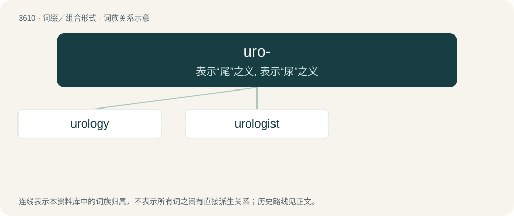

# 3676 · uro- — 表示“尾”之义, 表示“尿”之义

[总目录](../00_总目录_按常用程度.md)

**类型**：词缀／组合形式　｜　**来源语言**：见词源记录

## 核心含义与来源

- 核心含义：表示“尾”之义, 表示“尿”之义
- 英文含义：urine; relating to urine and the urinary system.
- 词形：uro-

**多个词源／构词路径**：同一拼写可能有不同来源；以下按词性和含义分别列出。

**来源记录 1**（前缀／前置成分；urine; relating to urine and the urinary system.）

From Ancient Greek οὖρον (oûron).

**来源记录 2**（前缀／前置成分；Tail.）

From New Latin, from Ancient Greek οὐρά (ourá, “tail”).

## 词族图

## 单词速览（常用到不常用）

| 单词 | 音标 | 释义 |
|---|---|---|
| [urology](#w-1) | /jʊəˈɹɒlədʒi/ | n. 泌尿科学；\[医\] 泌尿科学 |
| [urologist](#w-2) | /juəˈrɒlədʒist/ | n. 泌尿科医师；\[医\] 泌尿科学家, 泌尿科医师 |

## 逐词详解

### 1. urology

**词性**：名词　｜　**音标**：/jʊəˈɹɒlədʒi/

**中文释义**：n. 泌尿科学；\[医\] 泌尿科学

**英文义项**：The surgical specialty of medicine that treats disorders of the urinary tract and the urogenital system.

**构词拆分**：uro- + -logy

**词源与演化**：

From uro- + -logy.

**例句**：

> I have a urology appointment on the 20th.

### 2. urologist

**词性**：名词　｜　**音标**：/juəˈrɒlədʒist/

**中文释义**：n. 泌尿科医师；\[医\] 泌尿科学家, 泌尿科医师

**英文义项**：A doctor of urology.

**构词拆分**：urolog(y) + -ist；uro- + -logist

**词源与演化**：

From urolog(y) + -ist or uro- + -logist.

**例句**：

> John Jackson is a urologist, his wife Tao is an ear-nose-throat specialist.
