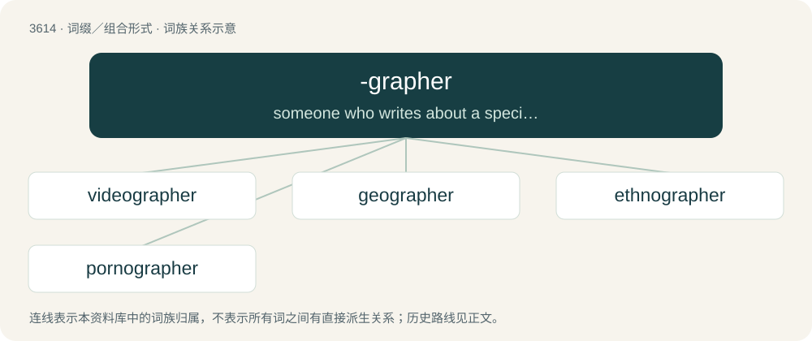

# 3678 · -grapher — someone who writes about a specified subject, or in a specified manner

[总目录](../00_总目录_按常用程度.md)

**类型**：词缀／组合形式　｜　**来源语言**：见词源记录

## 核心含义与来源

- 核心含义：someone who writes about a specified subject, or in a specified manner
- 英文含义：someone who writes about a specified subject, or in a specified manner
- 词形：-grapher

**来源记录 1**（后缀／后置成分；someone who writes about a specified subject, or in a specified manner）

From Ancient Greek γράφω (gráphō, “I draw, write or describe”) + -er.

## 词族图

## 单词速览（常用到不常用）

| 单词 | 音标 | 释义 |
|---|---|---|
| [videographer](#w-1) | /,vidiˈɔ^rəfə(r)/ | n. 电视录像制作人 |
| [geographer](#w-2) | 英 /d͡ʒiːˈɒɡ.ɹə.fə(ɹ)/；美 /d͡ʒiˈɑ.ɡɹə.fɚ/ | n. 地理学者 |
| [ethnographer](#w-3) | /eθˈnɒgrəfə/ | n. 人种志学者, 人种学者 |
| [pornographer](#w-4) | /pɔː(ɹ)ˈnɒɡɹəfə(ɹ)/ | n. 色情小说作家, 色情作品作者 |

## 逐词详解

### 1. videographer

**词性**：名词　｜　**音标**：/,vidiˈɔ^rəfə(r)/

**中文释义**：n. 电视录像制作人

**英文义项**：Any person involved in the production of video material, but especially a person who uses a video camera.

**构词拆分**：video- + -grapher

**词源与演化**：

From video- + -grapher.

**例句**：

> Ziri made Rima his official photographer and videographer.

### 2. geographer

**词性**：名词　｜　**音标**：英 /d͡ʒiːˈɒɡ.ɹə.fə(ɹ)/；美 /d͡ʒiˈɑ.ɡɹə.fɚ/

**中文释义**：n. 地理学者

**英文义项**：A specialist in geography.

**构词拆分**：geo- + -grapher

**词源与演化**：

From geo- + -grapher.

### 3. ethnographer

**词性**：名词　｜　**音标**：/eθˈnɒgrəfə/

**中文释义**：n. 人种志学者, 人种学者

**英文义项**：One who practices ethnography.

**构词拆分**：ethno- + -grapher

**词源与演化**：

From ethno- + -grapher.

### 4. pornographer

**词性**：名词　｜　**音标**：/pɔː(ɹ)ˈnɒɡɹəfə(ɹ)/

**中文释义**：n. 色情小说作家, 色情作品作者

**英文义项**：One who is involved in the creation or dissemination of pornography.

**构词拆分**：pornography + -er；porno- + -grapher

**词源与演化**：

From pornography + -er or porno- + -grapher.
