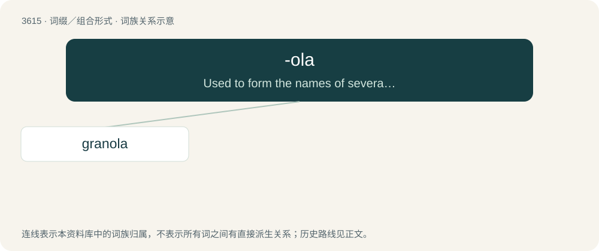

# 3679 · -ola — Used to form the names of several commercial companies and products.

[总目录](../00_总目录_按常用程度.md)

**类型**：词缀／组合形式　｜　**来源语言**：见词源记录

## 核心含义与来源

- 核心含义：Used to form the names of several commercial companies and products.
- 英文含义：Used to form the names of several commercial companies and products.
- 词形：-ola

**多个词源／构词路径**：同一拼写可能有不同来源；以下按词性和含义分别列出。

**来源记录 1**（后缀／后置成分；Used to form the names of several commercial companies and products.）

From Latin -ola, -ula, feminine form of -ulus, -lus (diminutive suffix).

**来源记录 2**（后缀／后置成分；Used to form words relating to oil or oiliness）

From Latin oleum (“oil, olive oil”).

## 词族图

## 单词速览（常用到不常用）

| 单词 | 音标 | 释义 |
|---|---|---|
| [granola](#w-1) | 美 /ɡɹəˈnoʊlə/ | n. （早餐营养食品）格兰诺拉燕麦卷 |

## 逐词详解

### 1. granola

**词性**：形容词　｜　**音标**：美 /ɡɹəˈnoʊlə/

**中文释义**：n. （早餐营养食品）格兰诺拉燕麦卷

**英文义项**：Eating healthy food, supporting the protection of the environment, and having liberal views.

**词源与演化**：

Genericized trademark from Granola, a brand of breakfast cereal registered in 1886 by Will Keith Kellogg and in use into the early 20th century. It was initially known as Granula and renamed Granola to avoid legal problems with James Caleb Jackson, who invented a similar cereal in 1863, named Granula after the granules of Graham flour, the main ingredient. The food and name were revived in the 1960s. By 1967, it appears in American English, probably from Italian grano (“grain”) or granular + the commercial suffix -ola.

**例句**：

> You see more and more of the granola hippie activist types these days.

该用例对应义项：Eating healthy food, supporting the protection of the environment, and having liberal views.
