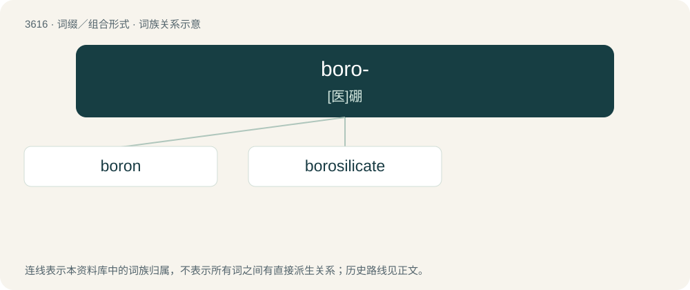

# 3680 · boro- — \[医\]硼

[总目录](../00_总目录_按常用程度.md)

**类型**：词缀／组合形式　｜　**来源语言**：见词源记录

## 核心含义与来源

- 核心含义：\[医\]硼
- 英文含义：boron
- 词形：boro-

**来源记录 1**（前缀／前置成分；boron）

From borax.

## 词族图

## 单词速览（常用到不常用）

| 单词 | 音标 | 释义 |
|---|---|---|
| [boron](#w-1) | /ˈbɔːˌɹɒn/ | n. 硼；\[化\] 硼B |
| [borosilicate](#w-2) | /,bɔːrəuˈsilikit/ | \[机\] 硼硅酸盐 |

## 逐词详解

### 1. boron

**词性**：名词　｜　**音标**：/ˈbɔːˌɹɒn/

**中文释义**：n. 硼；\[化\] 硼B

**英文义项**：The chemical element (symbol B) with an atomic number of 5, which is a metalloid found in its pure form as a dark amorphous powder. / An atom of this element.

**构词拆分**：boro- + -on

**词源与演化**：

From the stem of borax (boro-) + -on (based on carbon). Coined by British chemist Humphry Davy as a modification of his earlier word boracium.

**例句**：

> How many moles of boron are there in this solution?

### 2. borosilicate

**词性**：名词　｜　**音标**：/,bɔːrəuˈsilikit/

**中文释义**：\[机\] 硼硅酸盐

**英文义项**：Any of various minerals whose structure is formally that of a dual salt of boric and silicic acids.

**构词拆分**：boro- + silicate

**词源与演化**：

From boro- + silicate.
