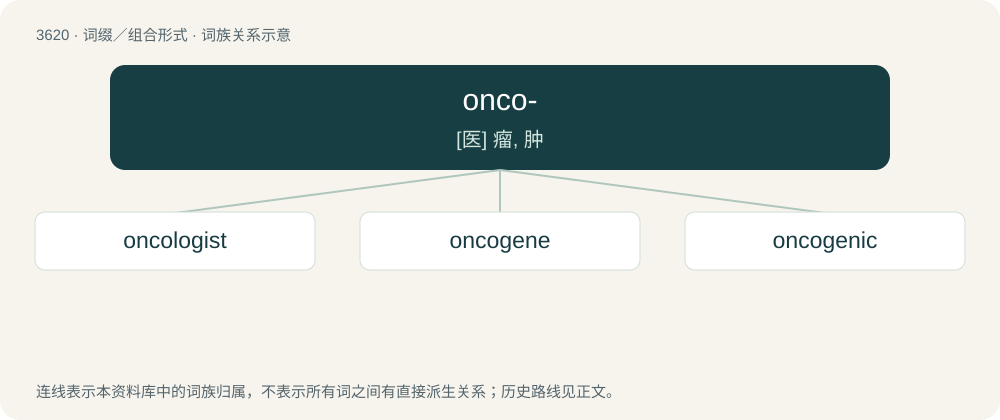

# 3681 · onco- — \[医\] 瘤, 肿

[总目录](../00_总目录_按常用程度.md)

**类型**：词缀／组合形式　｜　**来源语言**：见词源记录

## 核心含义与来源

- 核心含义：\[医\] 瘤, 肿
- 英文含义：Pertaining to tumors.
- 词形：onco-

**来源记录 1**（前缀／前置成分；Pertaining to tumors.）

First attested 1857, from New Latin onco- (“tumor”). from Ancient Greek ὄγκος (ónkos, “lump, mass, bulk”).

## 词族图

## 单词速览（常用到不常用）

| 单词 | 音标 | 释义 |
|---|---|---|
| [oncologist](#w-1) | /ɒŋˈkɒləd͡ʒɪst/ | n. 肿瘤学家；肿瘤医师 |
| [oncogene](#w-2) | 英 /ˈɒŋkə(ʊ)dʒiːn/ | \[化\] 致癌基因 |
| [oncogenic](#w-3) | /ˌɒŋkoʊˈd͡ʒɛnɪk/ | a. \[医\]瘤原性的,致瘤的 |

## 逐词详解

### 1. oncologist

**词性**：名词　｜　**音标**：/ɒŋˈkɒləd͡ʒɪst/

**中文释义**：n. 肿瘤学家；肿瘤医师

**英文义项**：A doctor or scientist who specializes in oncology.

**构词拆分**：oncology + -ist；onco- + -logist

**词源与演化**：

From oncology + -ist or onco- + -logist.

**例句**：

> The oncologist outlined a treatment plan for the cancer patient.

### 2. oncogene

**词性**：名词　｜　**音标**：英 /ˈɒŋkə(ʊ)dʒiːn/

**中文释义**：\[化\] 致癌基因

**英文义项**：Any gene that contributes to the conversion of a normal cell into a cancerous cell when mutated or expressed at high levels.

**构词拆分**：onco- + gene

**词源与演化**：

From onco- + gene.

### 3. oncogenic

**词性**：形容词　｜　**音标**：/ˌɒŋkoʊˈd͡ʒɛnɪk/

**中文释义**：a. \[医\]瘤原性的,致瘤的

**英文义项**：Causing the formation of tumors. / Arising from or caused by a tumor: tumor-induced.

**构词拆分**：onco- (“tumor”) + -genic (“producing”)

**词源与演化**：

From onco- (“tumor”) + -genic (“producing”).

**用法示例／搭配（非完整句）**：

> oncogenic osteomalacia

该用例对应义项：Arising from or caused by a tumor: tumor-induced.
