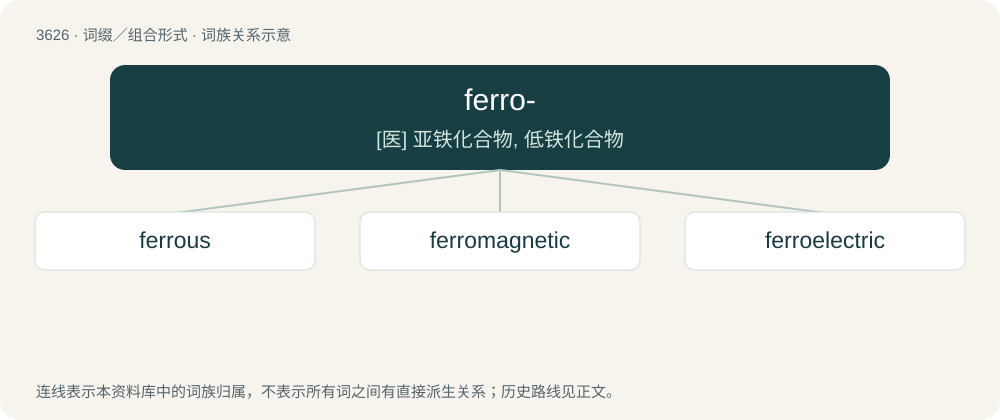

# 3683 · ferro- — \[医\] 亚铁化合物, 低铁化合物

[总目录](../00_总目录_按常用程度.md)

**类型**：词缀／组合形式　｜　**来源语言**：见词源记录

## 核心含义与来源

- 核心含义：\[医\] 亚铁化合物, 低铁化合物
- 英文含义：ferrous
- 词形：ferro-

## 词族图

## 单词速览（常用到不常用）

| 单词 | 音标 | 释义 |
|---|---|---|
| [ferrous](#w-1) | /ˈfɛɹəs/ | a. 铁的, 含铁的, 亚铁的；\[医\] 亚铁的 |
| [ferromagnetic](#w-2) | /.ferəumægˈnetik/ | a. 铁磁体；\[医\] 磁性铁的 |
| [ferroelectric](#w-3) | /,ferəuiˈlektrik/ | n. 铁电体；\[化\] 铁电的; 铁电体; 铁电物质 |

## 逐词详解

### 1. ferrous

**词性**：形容词　｜　**音标**：/ˈfɛɹəs/

**中文释义**：a. 铁的, 含铁的, 亚铁的；\[医\] 亚铁的

**英文义项**：Of or containing iron. / Of compounds of iron in which it has a valence or oxidation number of +2.

**构词拆分**：ferro- + -ous

**词源与演化**：

From ferro- + -ous, from Latin ferreus directly or via French ferreux, from ferrum (“iron”) + -eus (“-ous: forming adjectives”).

**用法示例／搭配（非完整句）**：

> ferrous metals

该用例对应义项：Of or containing iron.

### 2. ferromagnetic

**词性**：形容词　｜　**音标**：/.ferəumægˈnetik/

**中文释义**：a. 铁磁体；\[医\] 磁性铁的

**英文义项**：Exhibiting ferromagnetism.

**构词拆分**：ferro- + magnetic

**词源与演化**：

From ferro- + magnetic.

### 3. ferroelectric

**词性**：形容词　｜　**音标**：/,ferəuiˈlektrik/

**中文释义**：n. 铁电体；\[化\] 铁电的; 铁电体; 铁电物质

**英文义项**：of, or relating to the permanent electrical polarization of a crystalline dielectric in an electric field

**构词拆分**：ferro- + electric

**词源与演化**：

From ferro- + electric.
