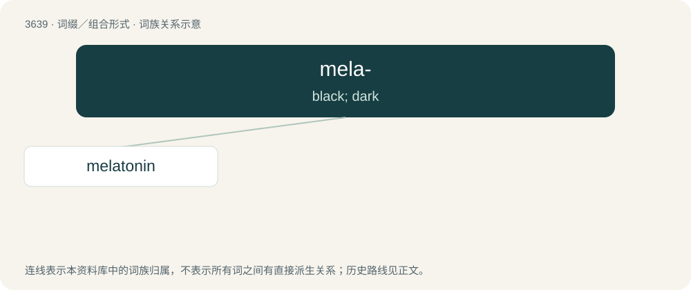

# 3691 · mela- — black; dark

[总目录](../00_总目录_按常用程度.md)

**类型**：词缀／组合形式　｜　**来源语言**：见词源记录

## 核心含义与来源

- 核心含义：black; dark
- 英文含义：black; dark
- 词形：mela-

**来源记录 1**（前缀／前置成分；black; dark）

From Ancient Greek μέλας (mélas, “black, dark”).

## 词族图

## 单词速览（常用到不常用）

| 单词 | 音标 | 释义 |
|---|---|---|
| [melatonin](#w-1) | 英 /ˌmɛləˈtəʊnɪn/；美 /ˌmɛləˈtoʊnɪn/ | \[化\] 褪黑激素; N-乙酰-5-甲氧基色胺 |

## 逐词详解

### 1. melatonin

**词性**：名词　｜　**音标**：英 /ˌmɛləˈtəʊnɪn/；美 /ˌmɛləˈtoʊnɪn/

**中文释义**：\[化\] 褪黑激素; N-乙酰-5-甲氧基色胺

**英文义项**：A hormone, related to serotonin, that is secreted by the pineal gland, and stimulates colour change in the skin of reptiles, and is involved in the sleep and wake and reproductive cycles in mammals. / Any material similar in its chemistry and effect to the natural hormone.

**构词拆分**：mela- + tone + -in

**词源与演化**：

From mela- + tone + -in, ultimately from Ancient Greek μέλας (mélas, “black, dark”).

**例句**：

> Melatonin helps to regulate circadian rhythms.
