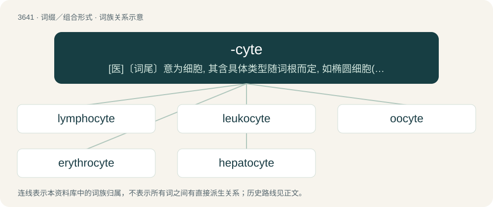

# 3692 · -cyte — \[医\]〔词尾〕意为细胞, 其含具体类型随词根而定, 如椭圆细胞(elliptocyte), 红细胞(erythro-cyte), 白细胞(leukocyte)等

[总目录](../00_总目录_按常用程度.md)

**类型**：词缀／组合形式　｜　**来源语言**：见词源记录

## 核心含义与来源

- 核心含义：\[医\]〔词尾〕意为细胞, 其含具体类型随词根而定, 如椭圆细胞(elliptocyte), 红细胞(erythro-cyte), 白细胞(leukocyte)等
- 英文含义：Used to form cell names and classifications for mature cells.
- 词形：-cyte

**来源记录 1**（后缀／后置成分；Used to form cell names and classifications for mature cells.）

From Latin cyta, from Ancient Greek κύτος (kútos, “vessel, jar”). Compare cyte.

## 词族图

## 单词速览（常用到不常用）

| 单词 | 音标 | 释义 |
|---|---|---|
| [lymphocyte](#w-1) | /ˈlimfəsait/ | n. 淋巴球, 淋巴细胞；\[化\] 淋巴细胞 |
| [leukocyte](#w-2) | /ˈluːkə(ʊ)sʌɪt/ | n. 白血球；\[医\] 白细胞(旧名白血球) |
| [oocyte](#w-3) | 英 /ˈəʊəsaɪt/；美 /ˈoʊəsaɪt/ | n. 卵母细胞；\[医\] 卵母细胞 |
| [erythrocyte](#w-4) | /əˈɹɪθɹəˌsaɪt/ | n. 红血球；\[医\] 红细胞 |
| [hepatocyte](#w-5) | /ˈhepətəsait/ | n. 肝细胞 |

## 逐词详解

### 1. lymphocyte

**词性**：名词　｜　**音标**：/ˈlimfəsait/

**中文释义**：n. 淋巴球, 淋巴细胞；\[化\] 淋巴细胞

**英文义项**：Any of several types of white blood cell with a spherical nucleus occurring in the lymphatic system, including B cells, T cells and natural killer cells.

**构词拆分**：lympho- + -cyte

**词源与演化**：

From lympho- + -cyte.

**例句**：

> A lymphocyte is a type of white blood cell.

### 2. leukocyte

**词性**：名词　｜　**音标**：/ˈluːkə(ʊ)sʌɪt/

**中文释义**：n. 白血球；\[医\] 白细胞(旧名白血球)

**英文义项**：Any of a class of blood cells that play various roles in cell-mediated immunity.

**构词拆分**：leuko- + -cyte

**词源与演化**：

From leuko- + -cyte.

### 3. oocyte

**词性**：名词　｜　**音标**：英 /ˈəʊəsaɪt/；美 /ˈoʊəsaɪt/

**中文释义**：n. 卵母细胞；\[医\] 卵母细胞

**英文义项**：A cell that develops into an egg or ovum; a female gametocyte.

**构词拆分**：oo- + -cyte

**词源与演化**：

From oo- + -cyte.

### 4. erythrocyte

**词性**：名词　｜　**音标**：/əˈɹɪθɹəˌsaɪt/

**中文释义**：n. 红血球；\[医\] 红细胞

**英文义项**：A hemoglobin-containing cell, especially as found in humans but more generally present in the blood of most vertebrates, that is involved with the transport of oxygen; such cells are usually anucleate in humans and many other animals.

**构词拆分**：erythro- (“red”) + -cyte (“cell”)

**词源与演化**：

From erythro- (“red”) + -cyte (“cell”), referring to the red color of hemoglobin when oxygen is bound to it.

### 5. hepatocyte

**词性**：名词　｜　**音标**：/ˈhepətəsait/

**中文释义**：n. 肝细胞

**英文义项**：Any of the cells in the liver responsible for the metabolism of protein, carbohydrate and lipid and for detoxification.

**构词拆分**：hepato- + -cyte

**词源与演化**：

From hepato- + -cyte.
