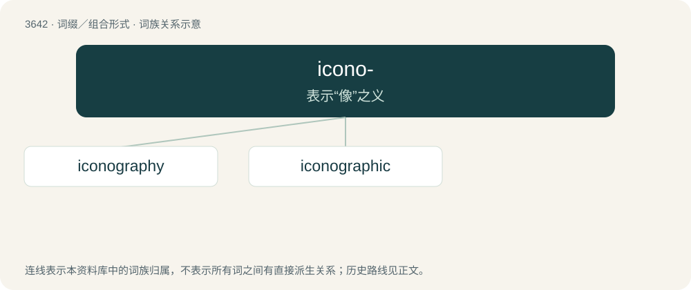

# 3695 · icono- — 表示“像”之义

[总目录](../00_总目录_按常用程度.md)

**类型**：词缀／组合形式　｜　**来源语言**：见词源记录

## 核心含义与来源

- 核心含义：表示“像”之义
- 英文含义：Forms terms relating to images or to icons
- 词形：icono-

**来源记录 1**（前缀／前置成分；Forms terms relating to images or to icons）

Equivalent to icon + -o-. From Ancient Greek εἰκών (eikṓn), as in terms such as εἰκονοκλάστης (eikonoklástēs).

## 词族图

## 单词速览（常用到不常用）

| 单词 | 音标 | 释义 |
|---|---|---|
| [iconography](#w-1) | /ˌaɪkəˈnɒɡɹəfi/ | n. 图像材料, 图示法, 肖像研究；\[医\] 影像学, 影像塑造术 |
| [iconographic](#w-2) | /ai.kɔnəˈɡræfik/ | a. 图像材料的；肖像学的；肖像的；图示法的象征 |

## 逐词详解

### 1. iconography

**词性**：名词　｜　**音标**：/ˌaɪkəˈnɒɡɹəfi/

**中文释义**：n. 图像材料, 图示法, 肖像研究；\[医\] 影像学, 影像塑造术

**英文义项**：A set of specified or traditional symbolic forms associated with the subject or theme of a stylized genre of art. / The art of representation by pictures or images; the description or study of portraiture or representation, as of persons.

**构词拆分**：icono- + -graphy

**词源与演化**：

From icono- + -graphy.

**用法示例／搭配（非完整句）**：

> the iconography of the ancients

该用例对应义项：The art of representation by pictures or images; the description or study of portraiture or representation, as of persons.

### 2. iconographic

**词性**：形容词　｜　**音标**：/ai.kɔnəˈɡræfik/

**中文释义**：a. 图像材料的；肖像学的；肖像的；图示法的象征

**英文义项**：Of or pertaining to iconography. / Of or pertaining to a secular person or topic that has attained cult status.

**构词拆分**：icono- + -graphic；iconography + -ic

**词源与演化**：

From icono- + -graphic or iconography + -ic.
