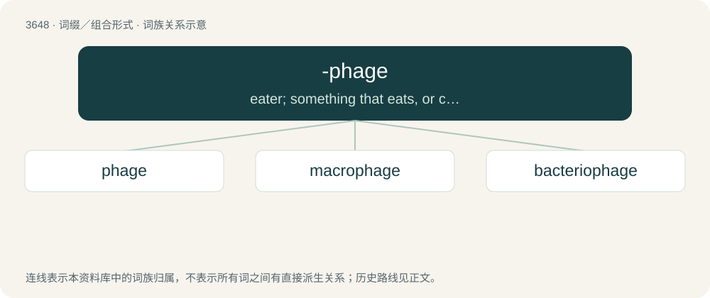

# 3701 · -phage — eater; something that eats, or consumes.

[总目录](../00_总目录_按常用程度.md)

**类型**：词缀／组合形式　｜　**来源语言**：见词源记录

## 核心含义与来源

- 核心含义：eater; something that eats, or consumes.
- 英文含义：eater; something that eats, or consumes.
- 词形：-phage

**来源记录 1**（后缀／后置成分；eater; something that eats, or consumes.）

From Latin -phagus, from Ancient Greek φάγος (phágos, “glutton”), from φαγεῖν (phageîn, “to eat”), aorist active infinitive of ἔφαγον (éphagon, “I ate, devoured”). Stem φαγ- (phag-) may also derive from Proto-Indo-European \*bʰeh₂g- (“to divide, distribute”) thus ultimately doublet of bhakti (via Sanskrit भक्ति (bhakti, “portion, division”) from root भज् (bhaj, “to divide, to apportion”)).

## 词族图

## 单词速览（常用到不常用）

| 单词 | 音标 | 释义 |
|---|---|---|
| [phage](#w-1) | /feɪd͡ʒ/ | n. 噬菌体；\[化\] 噬菌体 |
| [macrophage](#w-2) | 美 /ˈmækɹɔʊː.feɪd͡ʒ/ | n. 巨噬细胞；\[化\] 巨噬细胞 |
| [bacteriophage](#w-3) | /bækˈtɪəɹ.ɪəʊˌfeɪd͡ʒ/ | n. 噬菌体；\[医\] 噬菌体 |

## 逐词详解

### 1. phage

**词性**：名词　｜　**音标**：/feɪd͡ʒ/

**中文释义**：n. 噬菌体；\[化\] 噬菌体

**英文义项**：A virus that is parasitic on bacteria.

**构词拆分**：bacterio- (“bacteria”) + -phage (“eater”)

**词源与演化**：

Clipping of bacteriophage from bacterio- (“bacteria”) + -phage (“eater”); latter suffix from Ancient Greek -φάγος (-phágos, “eater”), from φαγ- (phag-), aorist stem of ἐσθίω (esthíō) or ἔδω (édō, “to eat, to consume”). Stem φαγ- (phag-) may also derive from Proto-Indo-European \*bʰeh₂g- (“to divide, distribute”) thus ultimately doublet of bhakti (via Sanskrit भक्ति (bhakti, “portion, division”) from root भज् (bhaj, “to divide, to apportion”)).

**例句**：

> Phage uses the bacterium's machinery and energy to produce more phage until the bacterium is destroyed and phage is released to invade surrounding bacteria.

该用例对应义项：a virus that is parasitic (reproduces itself) in bacteria

### 2. macrophage

**词性**：名词　｜　**音标**：美 /ˈmækɹɔʊː.feɪd͡ʒ/

**中文释义**：n. 巨噬细胞；\[化\] 巨噬细胞

**英文义项**：A white blood cell that phagocytizes necrotic cell debris and foreign material, including viruses, bacteria, and tattoo ink. It presents foreign antigens on MHC II to lymphocytes. Part of the innate immune system.

**构词拆分**：macro- + -phage

**词源与演化**：

From macro- + -phage, both from Ancient Greek.

### 3. bacteriophage

**词性**：名词　｜　**音标**：/bækˈtɪəɹ.ɪəʊˌfeɪd͡ʒ/

**中文释义**：n. 噬菌体；\[医\] 噬菌体

**英文义项**：A virus that specifically infects bacteria.

**构词拆分**：bacterio- (“bacteria”) + -phage (“eater”)

**词源与演化**：

Borrowed from French bactériophage, coined by microbiologist Félix d'Hérelle, from bacterio- (“bacteria”) + -phage (“eater”).
