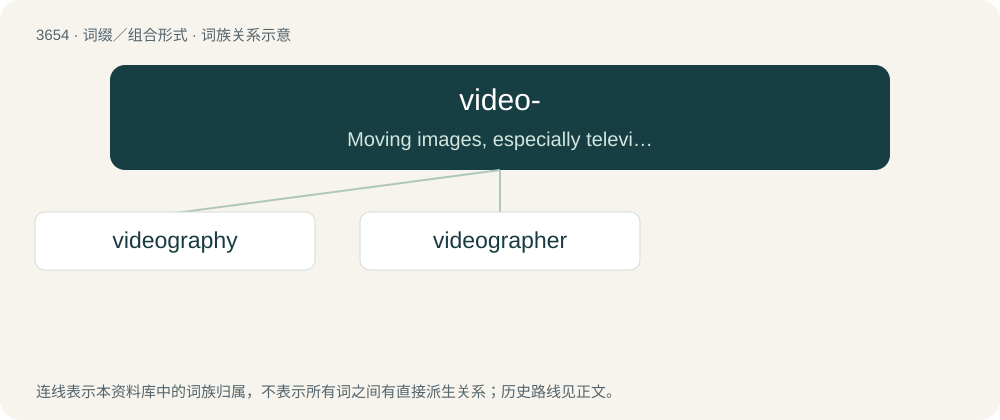

# 3703 · video- — Moving images, especially television.

[总目录](../00_总目录_按常用程度.md)

**类型**：词缀／组合形式　｜　**来源语言**：见词源记录

## 核心含义与来源

- 核心含义：Moving images, especially television.
- 英文含义：Moving images, especially television.
- 词形：video-

**来源记录 1**（前缀／前置成分；Moving images, especially television.）

From video.

## 词族图

## 单词速览（常用到不常用）

| 单词 | 音标 | 释义 |
|---|---|---|
| [videography](#w-1) | /,vidiˈɔ^rəfi/ | 电视录像制作, 录像片(或盘)摄制, 摄像 |
| [videographer](#w-2) | /,vidiˈɔ^rəfə(r)/ | n. 电视录像制作人 |

## 逐词详解

### 1. videography

**词性**：名词　｜　**音标**：/,vidiˈɔ^rəfi/

**中文释义**：电视录像制作, 录像片(或盘)摄制, 摄像

**英文义项**：The art and technology of producing moving (video) images on photosensitive surfaces, and its digital counterpart. / The occupation of making videos.

**构词拆分**：video- + -graphy

**词源与演化**：

From video- + -graphy.

**例句**：

> Alberto was paying Isabella for her videography and photography skills.

### 2. videographer

**词性**：名词　｜　**音标**：/,vidiˈɔ^rəfə(r)/

**中文释义**：n. 电视录像制作人

**英文义项**：Any person involved in the production of video material, but especially a person who uses a video camera.

**构词拆分**：video- + -grapher

**词源与演化**：

From video- + -grapher.

**例句**：

> Ziri made Rima his official photographer and videographer.
