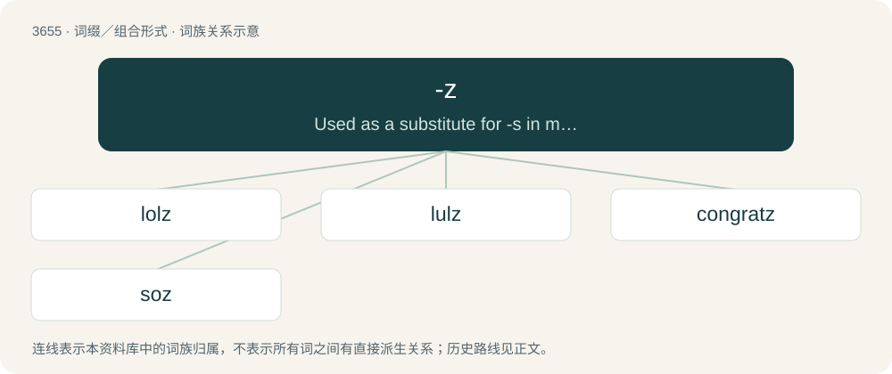

# 3704 · -z — Used as a substitute for -s in marking the plural of nouns. Usually used in words in which the -s suffix is actually pronounced /z/.

[总目录](../00_总目录_按常用程度.md)

**类型**：词缀／组合形式　｜　**来源语言**：见词源记录

## 核心含义与来源

- 核心含义：Used as a substitute for -s in marking the plural of nouns. Usually used in words in which the -s suffix is actually pronounced /z/.
- 英文含义：Used as a substitute for -s in marking the plural of nouns. Usually used in words in which the -s suffix is actually pronounced /z/.
- 词形：-z

**多个词源／构词路径**：同一拼写可能有不同来源；以下按词性和含义分别列出。

**来源记录 1**（后缀／后置成分；Used as a substitute for -s in marking the plural of nouns. Usually used in words in which the -s suffix is actually pronounced /z/.）

An eye dialect spelling variant of -s.

**来源记录 2**（后缀／后置成分；Forms nicknames, especially of personal names.）

From a mutation (specifically a zetacism) of the rhotic consonant /ɹ/ to /z/. While standalone suffixation (such as soz and Baz) gained wide recognition in British print during the 1980s, the underlying morphophonological shift is attested significantly earlier in Australian English via the derived non‐rhotic suffix -zza (such as Bazza for Barry), which has been in print since at least the 1960s.

## 词族图

## 单词速览（常用到不常用）

| 单词 | 音标 | 释义 |
|---|---|---|
| [lolz](#w-1) | /ˈlɔːlz/ | 【英文】Used to express laughter, often in a sarcastic fashion. |
| [lulz](#w-2) | /lʌlz/ | 【英文】Fun; amusement; humor; especially schadenfreude. |
| [congratz](#w-3) |  | 【英文】congratulations |
| [soz](#w-4) | 英 /sɒz/ | n. \[热血传奇\]sorry. 对不起。 |

## 逐词详解

### 1. lolz

**词性**：感叹词　｜　**音标**：/ˈlɔːlz/

**英文义项**：Used to express laughter, often in a sarcastic fashion.

**词源与演化**：

A corruption of lol, probably a leet variation, treated as if it were a noun rather than an interjection and pluralized in a deliberately unconventional manner using the -z suffix.

### 2. lulz

**词性**：名词　｜　**音标**：/lʌlz/

**英文义项**：Fun; amusement; humor; especially schadenfreude.

**词源与演化**：

Alteration of lol using the suffix -z, a deliberately nonstandard variant of the plural marker -s.

**例句**：

> I did it for the lulz.

### 3. congratz

**词性**：感叹词

**英文义项**：congratulations

**构词拆分**：congrats + -z

**词源与演化**：

From congrats + -z.

### 4. soz

**词性**：感叹词　｜　**音标**：英 /sɒz/

**中文释义**：n. \[热血传奇\]sorry. 对不起。

**英文义项**：Synonym of sorry.

**构词拆分**：sorry + -z

**词源与演化**：

Rhotacism of sorry; sorry + -z. Documented since at least 1987. Compare appaz (“apparently”), tomoz (“tomorrow”).
