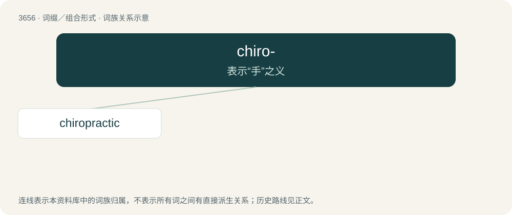

# 3706 · chiro- — 表示“手”之义

[总目录](../00_总目录_按常用程度.md)

**类型**：词缀／组合形式　｜　**来源语言**：见词源记录

## 核心含义与来源

- 核心含义：表示“手”之义
- 英文含义：hand
- 词形：chiro-

## 词族图

## 单词速览（常用到不常用）

| 单词 | 音标 | 释义 |
|---|---|---|
| [chiropractic](#w-1) | /ˌkaɪɹəˈpɹæktɪk/ | n. (脊柱)按摩疗法；\[医\] 按摩疗法 |

## 逐词详解

### 1. chiropractic

**词性**：名词　｜　**音标**：/ˌkaɪɹəˈpɹæktɪk/

**中文释义**：n. (脊柱)按摩疗法；\[医\] 按摩疗法

**英文义项**：A system of health care involving manipulation of the spinal column and other body structures, for the purpose of alleviating neuromusculoskeletal dysfunction.

**构词拆分**：chiro- (“hand”) + practic

**词源与演化**：

From chiro- (“hand”) + practic; from Ancient Greek χείρ (kheír, “hand”) + πρακτικός (praktikós, “concerned with action”).

**例句**：

> Chiropractic is a massage technique to put the vertebrae back in the right position, but it is not part of medicine itself.
