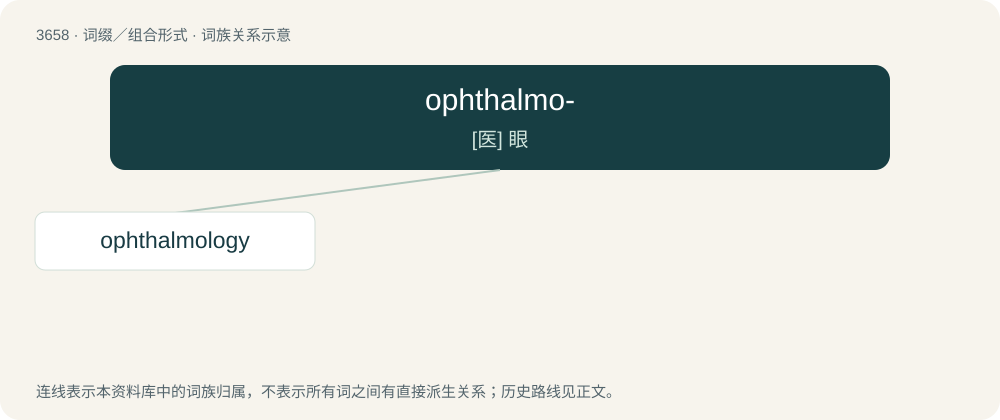

# 3707 · ophthalmo- — \[医\] 眼

[总目录](../00_总目录_按常用程度.md)

**类型**：词缀／组合形式　｜　**来源语言**：见词源记录

## 核心含义与来源

- 核心含义：\[医\] 眼
- 英文含义：Of or relating to eyes.
- 词形：ophthalmo-

**来源记录 1**（前缀／前置成分；Of or relating to eyes.）

From Ancient Greek ὀφθαλμός (ophthalmós, “eye”).

## 词族图

## 单词速览（常用到不常用）

| 单词 | 音标 | 释义 |
|---|---|---|
| [ophthalmology](#w-1) | 英 /ˌɒfθə(l)ˈmɒləd͡ʒi/；美 /ˌɑpθə(l)ˈmɑləd͡ʒi/ | n. 眼科学；\[医\] 眼科学 |

## 逐词详解

### 1. ophthalmology

**词性**：名词　｜　**音标**：英 /ˌɒfθə(l)ˈmɒləd͡ʒi/；美 /ˌɑpθə(l)ˈmɑləd͡ʒi/

**中文释义**：n. 眼科学；\[医\] 眼科学

**英文义项**：The anatomy, functions, pathology, and treatment of the eye.

**构词拆分**：ophthalmo- + -logy

**词源与演化**：

From ophthalmo- + -logy.
