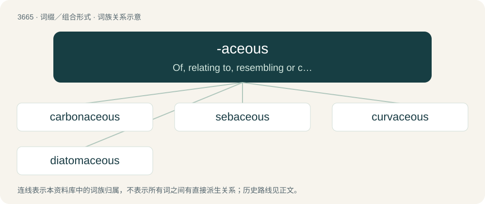

# 3714 · -aceous — Of, relating to, resembling or containing the thing suffixed

[总目录](../00_总目录_按常用程度.md)

**类型**：词缀／组合形式　｜　**来源语言**：见词源记录

## 核心含义与来源

- 核心含义：Of, relating to, resembling or containing the thing suffixed
- 英文含义：Of, relating to, resembling or containing the thing suffixed
- 词形：-aceous

**来源记录 1**（后缀／后置成分；Of, relating to, resembling or containing the thing suffixed）

Suffixal construction from (1) Latin ‑āceus (“belonging to, of the nature of”) + -ous, from oblique stem of -āx, -ācis + -eus and (2) -acea + -ous. Also variant of -acious.

## 词族图

## 单词速览（常用到不常用）

| 单词 | 音标 | 释义 |
|---|---|---|
| [carbonaceous](#w-1) | 英 /kɑːbəˈneɪʃəs/ | a. 碳的, 碳质的, 含碳的；\[建\] 含碳的 |
| [sebaceous](#w-2) | 美 /səˈbeɪ.ʃəs/ | a. 脂肪的, 脂肪质的, 分泌脂肪的；\[医\] 皮脂的, 分泌脂质的 |
| [curvaceous](#w-3) | 美 /kɚˈveɪ.ʃɪs/ | a. 曲线美的, 肉体美的 |
| [diatomaceous](#w-4) | /ˌdaɪ.ə.təˈmeɪ.ʃəs/ | a. 硅藻的, 含硅藻的, 硅藻化石遗址构成的 |

## 逐词详解

### 1. carbonaceous

**词性**：形容词　｜　**音标**：英 /kɑːbəˈneɪʃəs/

**中文释义**：a. 碳的, 碳质的, 含碳的；\[建\] 含碳的

**英文义项**：Of, relating to, rich in, or yielding carbon, or a compound of carbon.

**构词拆分**：carbon + -aceous

**词源与演化**：

From carbon + -aceous.

### 2. sebaceous

**词性**：形容词　｜　**音标**：美 /səˈbeɪ.ʃəs/

**中文释义**：a. 脂肪的, 脂肪质的, 分泌脂肪的；\[医\] 皮脂的, 分泌脂质的

**英文义项**：Of or relating to fat, sebum. / Oozing fat.

**词源与演化**：

Borrowed from Latin sebaceus (whence -aceous), from Latin sebum, from Proto-Indo-European \*seyb- (“to pour out”), which Proto-Germanic \*saipǭ ("soap") is also derived from.

**用法示例／搭配（非完整句）**：

> a sebaceous plant secretion

该用例对应义项：Tallowy, waxy.

### 3. curvaceous

**词性**：形容词　｜　**音标**：美 /kɚˈveɪ.ʃɪs/

**中文释义**：a. 曲线美的, 肉体美的

**英文义项**：Having shapely and voluptuous curves; curvy.

**构词拆分**：curv(e) + -aceous

**词源与演化**：

From curv(e) + -aceous. Originally American English. First attested in the 1930s.

**例句**：

> Hollywood seems full of curvaceous blondes.

该用例对应义项：(of a woman's body) having a large bosom and pleasing curves

### 4. diatomaceous

**词性**：形容词　｜　**音标**：/ˌdaɪ.ə.təˈmeɪ.ʃəs/

**中文释义**：a. 硅藻的, 含硅藻的, 硅藻化石遗址构成的

**英文义项**：Of, pertaining to, or containing diatoms or their coverings.

**构词拆分**：From diatom + -aceous.

**词源与演化**：

From diatom + -aceous.
