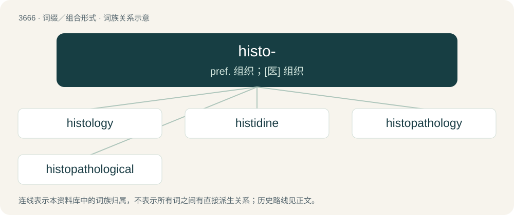

# 3715 · histo- — pref. 组织；\[医\] 组织

[总目录](../00_总目录_按常用程度.md)

**类型**：词缀／组合形式　｜　**来源语言**：见词源记录

## 核心含义与来源

- 核心含义：pref. 组织；\[医\] 组织
- 英文含义：tissue
- 词形：histo-

**来源记录 1**（前缀／前置成分；tissue）

Borrowed from Ancient Greek ῐ̔στός (hĭstós, “web, tissue”). Unrelated to English history.

## 词族图

## 单词速览（常用到不常用）

| 单词 | 音标 | 释义 |
|---|---|---|
| [histology](#w-1) | /hɪsˈtɒləd͡ʒi/ | n. 组织学；\[化\] 组织学 |
| [histidine](#w-2) | /ˈhɪstɪdiːn/ | n. \[生化\]组氨酸, 组织氨基酸 |
| [histopathology](#w-3) | /,histəupəˈθɔːlədʒi/ | \[医\] 病理组织学 |
| [histopathological](#w-4) | /ˈhistəj,pæθəˈlɔdʒikəl/ | a. 组织病理学说的 |

## 逐词详解

### 1. histology

**词性**：名词　｜　**音标**：/hɪsˈtɒləd͡ʒi/

**中文释义**：n. 组织学；\[化\] 组织学

**英文义项**：The study of the microscopic structure, chemical composition and function of the tissue or tissue systems of plants and animals. / Histopathology.

**构词拆分**：histo- + -logy

**词源与演化**：

From histo- + -logy.

### 2. histidine

**词性**：名词　｜　**音标**：/ˈhɪstɪdiːn/

**中文释义**：n. \[生化\]组氨酸, 组织氨基酸

**英文义项**：An essential amino acid C₆H₉N₃O₂ found in most animal proteins; essential for tissue growth and repair.

**构词拆分**：histo- + -idine

**词源与演化**：

From histo- + -idine.

### 3. histopathology

**词性**：名词　｜　**音标**：/,histəupəˈθɔːlədʒi/

**中文释义**：\[医\] 病理组织学

**英文义项**：The microscopic study of tissue, especially of abnormal tissue as a result of disease.

**构词拆分**：histo- + pathology

**词源与演化**：

From histo- + pathology.

### 4. histopathological

**词性**：形容词　｜　**音标**：/ˈhistəj,pæθəˈlɔdʒikəl/

**中文释义**：a. 组织病理学说的

**英文义项**：Of or pertaining to histopathology

**构词拆分**：histo- + pathological

**词源与演化**：

From histo- + pathological.
