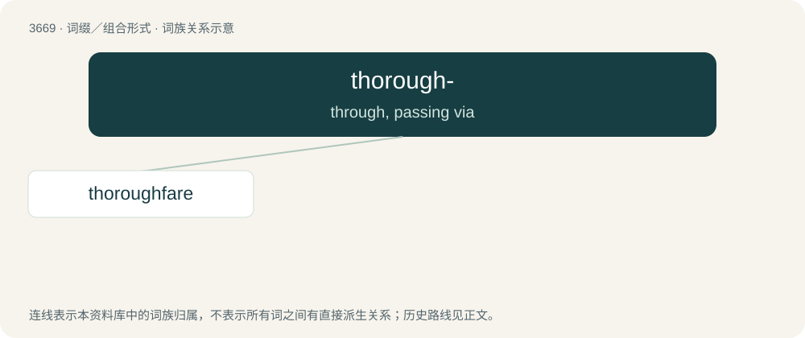

# 3717 · thorough- — through, passing via

[总目录](../00_总目录_按常用程度.md)

**类型**：词缀／组合形式　｜　**来源语言**：见词源记录

## 核心含义与来源

- 核心含义：through, passing via
- 英文含义：through, passing via
- 词形：thorough-

**来源记录 1**（前缀／前置成分；through, passing via）

A variant of through-, common in 16th-19th centuries, particularly where there is a perceived connection with thorough “thorough-”, in OED Online ⁠, Oxford: Oxford University Press, launched 2000..

## 词族图

## 单词速览（常用到不常用）

| 单词 | 音标 | 释义 |
|---|---|---|
| [thoroughfare](#w-1) | 英 /ˈθʌɹəfɛː/；/ˈθəɹ.ə.fɛɹ/ | n. 通路, 大道 |

## 逐词详解

### 1. thoroughfare

**词性**：名词　｜　**音标**：英 /ˈθʌɹəfɛː/；/ˈθəɹ.ə.fɛɹ/

**中文释义**：n. 通路, 大道

**英文义项**：A passage; a way through. / A road open at both ends or connecting one area with another; a highway or main street.

**构词拆分**：thorough- (“through”) + fare

**词源与演化**：

From Middle English thurghfare, corresponding to thorough- (“through”) + fare. Compare Old English þurhfaran (“to go through, go over, traverse, pierce, pass through, pass beyond, transcend, penetrate”). Compare also Old English þurhfær (“inner secret place”), German Durchfahrt (“passage through, thoroughfare”).

**例句**：

> The sign leading to the other carriage reads: No thoroughfare.

该用例对应义项：The act of going through; passage; travel, transit.
