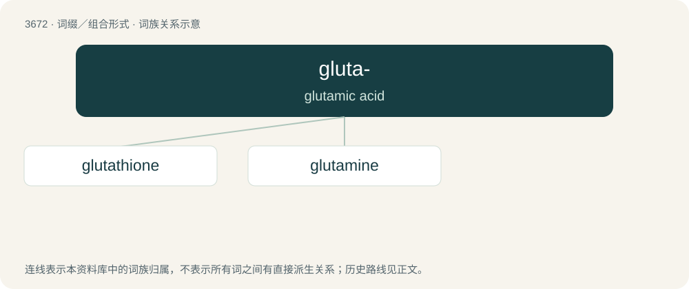

# 3718 · gluta- — glutamic acid

[总目录](../00_总目录_按常用程度.md)

**类型**：词缀／组合形式　｜　**来源语言**：见词源记录

## 核心含义与来源

- 核心含义：glutamic acid
- 英文含义：glutamic acid
- 词形：gluta-

## 词族图

## 单词速览（常用到不常用）

| 单词 | 音标 | 释义 |
|---|---|---|
| [glutathione](#w-1) | /ˌɡluːtəˈθaɪəʊn/ | \[医\] 谷胱甘肽 |
| [glutamine](#w-2) | /ˈɡlutəmiːn/ | n. 谷氨酸盐；\[医\] 谷酰胺 |

## 逐词详解

### 1. glutathione

**词性**：名词　｜　**音标**：/ˌɡluːtəˈθaɪəʊn/

**中文释义**：\[医\] 谷胱甘肽

**英文义项**：A tripeptide formed from glutamic acid, cysteine and glycine, that is active in many biological redox reactions.

**构词拆分**：From gluta- + thione.

**词源与演化**：

From gluta- + thione.

### 2. glutamine

**词性**：名词　｜　**音标**：/ˈɡlutəmiːn/

**中文释义**：n. 谷氨酸盐；\[医\] 谷酰胺

**英文义项**：A nonessential amino acid C₅H₁₀N₂O₃ found in most animal and plant proteins.

**构词拆分**：gluta- + -amine

**词源与演化**：

From gluta- + -amine.
