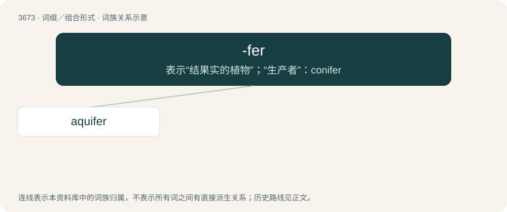

# 3720 · -fer — 表示“结果实的植物”；“生产者”：conifer

[总目录](../00_总目录_按常用程度.md)

**类型**：词缀／组合形式　｜　**来源语言**：见词源记录

## 核心含义与来源

- 核心含义：表示“结果实的植物”；“生产者”：conifer
- 英文含义：Holder or bearer of something.
- 词形：-fer

**来源记录 1**（后缀／后置成分；Holder or bearer of something.）

Derived from Latin -fer (“bearer”).

## 词族图

## 单词速览（常用到不常用）

| 单词 | 音标 | 释义 |
|---|---|---|
| [aquifer](#w-1) | 英 /ˈækwɪfə/；美 /ˈɑkwɪfɝ/ | \[化\] 含水层 |

## 逐词详解

### 1. aquifer

**词性**：名词　｜　**音标**：英 /ˈækwɪfə/；美 /ˈɑkwɪfɝ/

**中文释义**：\[化\] 含水层

**英文义项**：An underground layer of water-bearing porous stone, earth, or gravel.

**构词拆分**：aqui- + -fer

**词源与演化**：

From aqui- + -fer.

**例句**：

> The water in the well came from an aquifer.

该用例对应义项：An underground layer of water-bearing porous stone, earth, or gravel.
