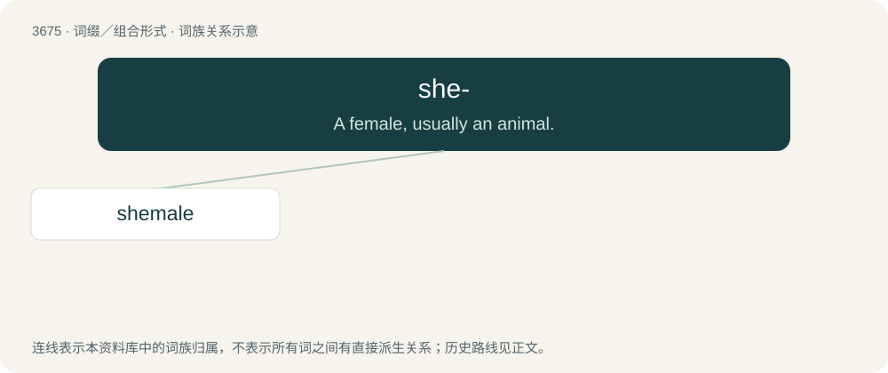

# 3722 · she- — A female, usually an animal.

[总目录](../00_总目录_按常用程度.md)

**类型**：词缀／组合形式　｜　**来源语言**：见词源记录

## 核心含义与来源

- 核心含义：A female, usually an animal.
- 英文含义：A female, usually an animal.
- 词形：she-

## 词族图

## 单词速览（常用到不常用）

| 单词 | 音标 | 释义 |
|---|---|---|
| [shemale](#w-1) | 美 /ˈʃi.meɪl/ | \[美俚\]女人, 女性 |

## 逐词详解

### 1. shemale

**词性**：名词　｜　**音标**：美 /ˈʃi.meɪl/

**中文释义**：\[美俚\]女人, 女性

**英文义项**：A male-to-female transsexual or transgender person; a trans woman. / A male or non-binary person with feminine characteristics; a femboy.

**构词拆分**：she- + male

**词源与演化**：

From she- + male.

**例句**：

> I didn't know Catherine was a shemale.
