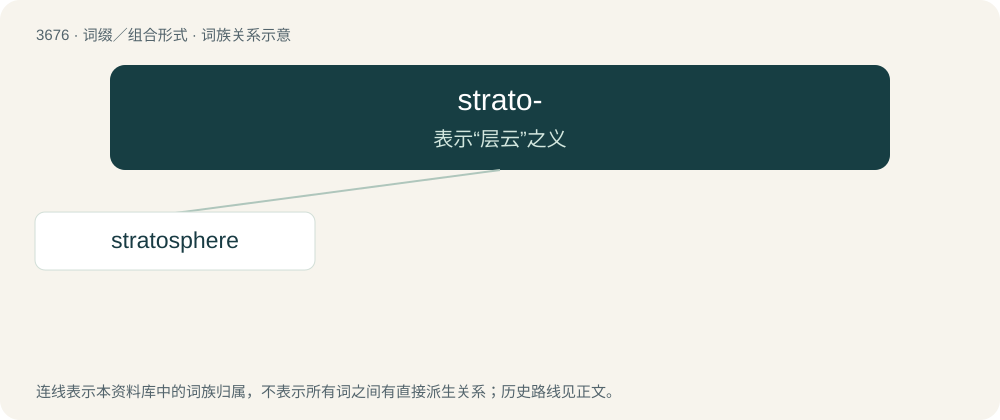

# 3723 · strato- — 表示“层云”之义

[总目录](../00_总目录_按常用程度.md)

**类型**：词缀／组合形式　｜　**来源语言**：见词源记录

## 核心含义与来源

- 核心含义：表示“层云”之义
- 英文含义：Strata; especially, stratus clouds.
- 词形：strato-

## 词族图

## 单词速览（常用到不常用）

| 单词 | 音标 | 释义 |
|---|---|---|
| [stratosphere](#w-1) | 英 /ˈstɹætəsfɪə/；美 /ˈstɹætəsfɪɚ/ | n. 同温层, 最上层, 尖端的学科领域；\[医\] 同温层, 平流层 |

## 逐词详解

### 1. stratosphere

**词性**：名词　｜　**音标**：英 /ˈstɹætəsfɪə/；美 /ˈstɹætəsfɪɚ/

**中文释义**：n. 同温层, 最上层, 尖端的学科领域；\[医\] 同温层, 平流层

**英文义项**：The region of the uppermost atmosphere where the temperature increases along with the altitude due to the absorption of solar ultraviolet radiation by ozone. / Collectively, those layers of the Earth’s crust which primarily comprise stratified deposits.

**构词拆分**：strato- + -sphere

**词源与演化**：

From French stratosphère, a word coined by its discoverer, meteorologist Léon Teisserenc de Bort. From strato- + -sphere.

**例句**：

> Ozone in the stratosphere absorbs some of the sun’s harmful ultraviolet radiation.
