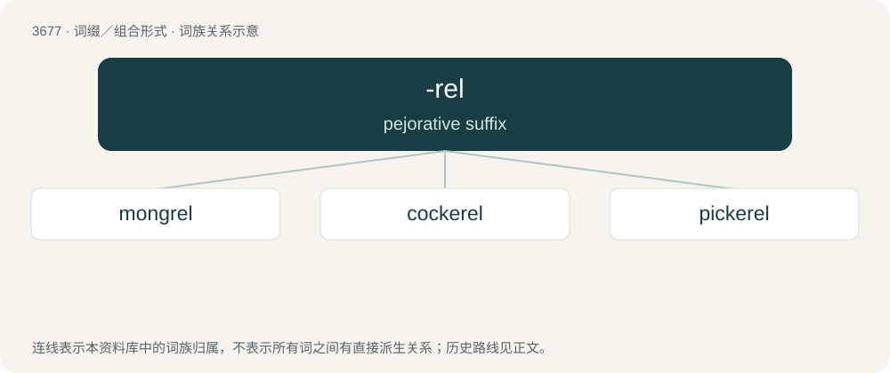

# 3724 · -rel — pejorative suffix

[总目录](../00_总目录_按常用程度.md)

**类型**：词缀／组合形式　｜　**来源语言**：见词源记录

## 核心含义与来源

- 核心含义：pejorative suffix
- 英文含义：pejorative suffix
- 词形：-rel

**来源记录 1**（后缀／后置成分；pejorative suffix）

From Middle English -rel, -erel, from Old French -erel, -erelle.

## 词族图

## 单词速览（常用到不常用）

| 单词 | 音标 | 释义 |
|---|---|---|
| [mongrel](#w-1) | 英 /ˈmʌŋ.ɡɹəl/；美 /ˈmɑŋ.ɡɹəl/ | n. 杂种, 杂种狗, 混血儿；a. 杂种的, 混血儿的 |
| [cockerel](#w-2) | 英 /ˈkɒkəɹəl/；美 /ˈkɑkəɹəl/ | n. 小公鸡 |
| [pickerel](#w-3) | 英 /ˈpɪk(ə)ɹəl/ | n. 狗鱼 |

## 逐词详解

### 1. mongrel

**词性**：名词　｜　**音标**：英 /ˈmʌŋ.ɡɹəl/；美 /ˈmɑŋ.ɡɹəl/

**中文释义**：n. 杂种, 杂种狗, 混血儿；a. 杂种的, 混血儿的

**英文义项**：A dog with a lineage of two or more breeds. / A person of mixed race.

**构词拆分**：mong (“mixture”) + -rel (pejorative diminutive)

**词源与演化**：

From Middle English mongrel, equivalent to mong (“mixture”) + -rel (pejorative diminutive); from Old English ġemang (“mingling”) (whence Modern English among), from Proto-Germanic \*mang- (“mix; mixture”).

**例句**：

> That dog is a mongrel; who knows what breed it could be!

该用例对应义项：A dog with a lineage of two or more breeds.

### 2. cockerel

**词性**：名词　｜　**音标**：英 /ˈkɒkəɹəl/；美 /ˈkɑkəɹəl/

**中文释义**：n. 小公鸡

**英文义项**：A young male chicken.

**构词拆分**：By surface analysis, cock + -rel

**词源与演化**：

From Middle English kokerel. By surface analysis, cock + -rel.

**例句**：

> The cockerel, herald of the morning, wakes those of us sleeping.

### 3. pickerel

**词性**：名词　｜　**音标**：英 /ˈpɪk(ə)ɹəl/

**中文释义**：n. 狗鱼

**英文义项**：A freshwater fish of the genus Esox. / Walleye, A species of gamefish, Sander vitreus, native to the Northern U.S. and Canada with pale, reflective eyes.

**构词拆分**：pike + -rel

**词源与演化**：

From Middle English pikerel; equivalent to pike + -rel.
