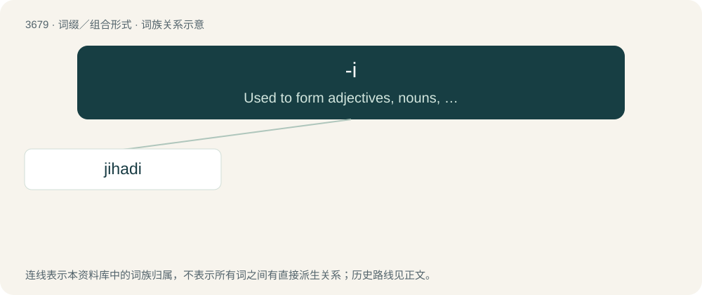

# 3726 · -i — Used to form adjectives, nouns, demonyms (describing people of a particular city, region or country) or genonyms (describing people of a particular tribe, clan or family) and the l

[总目录](../00_总目录_按常用程度.md)

**类型**：词缀／组合形式　｜　**来源语言**：见词源记录

## 核心含义与来源

- 核心含义：Used to form adjectives, nouns, demonyms (describing people of a particular city, region or country) or genonyms (describing people of a particular tribe, clan or family) and the language spoken by these people.
- 英文含义：Used to form adjectives, nouns, demonyms (describing people of a particular city, region or country) or genonyms (describing people of a particular tribe, clan or family) and the language spoken by these people.
- 词形：-i

**多个词源／构词路径**：同一拼写可能有不同来源；以下按词性和含义分别列出。

**来源记录 1**（后缀／后置成分；Used to form adjectives, nouns, demonyms (describing people of a particular city, region or country) or genonyms (describing people of a particular tribe, clan or family) and the language spoken by these people.）

A conflation of the following suffixes: \* For Semitic-speaking places, from the Arabic ـِيّ (-iyy) (nisba suffix) and from Hebrew ־י (-i), both sharing a common Semitic root. \* For Indo-Iranian-speaking places, from Persian ـی (-ī) and Hindustani Hindi -ई (-ī) / Urdu ـی (-ī). In English, productive since the 19th century.

**来源记录 2**（后缀／后置成分；Forms an alternative plural ending for various words borrowed from Latin that end in ⟨us⟩ in the singular.）

From Latin -ī (nominative plural).

**来源记录 3**（后缀／后置成分；Forms an alternative plural ending for words borrowed from Italian that end in ⟨o⟩ or ⟨e⟩ in the singular.）

From Italian -i (masculine plural), from Latin -ī (see etymology 2).

**来源记录 4**（后缀／后置成分；Used to form diminutives of given names.）

Variant of -ie or -y.

## 词族图

## 单词速览（常用到不常用）

| 单词 | 音标 | 释义 |
|---|---|---|
| [jihadi](#w-1) | /d͡ʒɪˈhɑːdi/ | 圣战分子; 圣战的; 跟圣战有关的 |

## 逐词详解

### 1. jihadi

**词性**：名词　｜　**音标**：/d͡ʒɪˈhɑːdi/

**中文释义**：圣战分子; 圣战的; 跟圣战有关的

**英文义项**：A jihadist.

**构词拆分**：jihad + -i

**词源与演化**：

From jihad + -i, after Arabic جِهَادِيّ (jihādiyy). Both the noun and the adjective are in occasional use since the 1960s.
