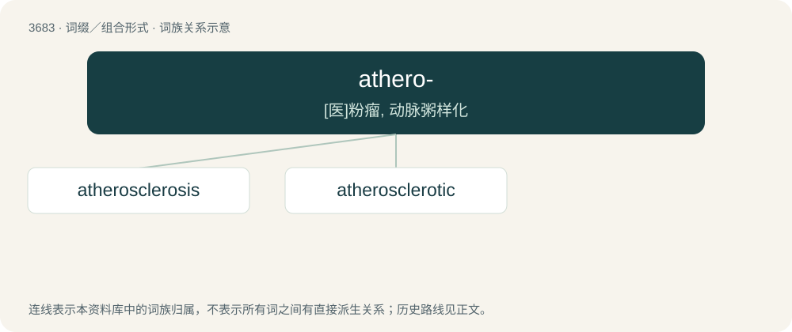

# 3734 · athero- — \[医\]粉瘤, 动脉粥样化

[总目录](../00_总目录_按常用程度.md)

**类型**：词缀／组合形式　｜　**来源语言**：见词源记录

## 核心含义与来源

- 核心含义：\[医\]粉瘤, 动脉粥样化
- 英文含义：arterial conditions that are characterised by gruel-like lesions
- 词形：athero-

**来源记录 1**（前缀／前置成分；arterial conditions that are characterised by gruel-like lesions）

From international scientific vocabulary, reflecting a New Latin combining form, from Ancient Greek ἀθάρη (athárē, “gruel”).

## 词族图

## 单词速览（常用到不常用）

| 单词 | 音标 | 释义 |
|---|---|---|
| [atherosclerosis](#w-1) | Canada /ˌæθɚoʊskləˈɹoʊsəs/ | n. 动脉粥样硬化；\[医\] \[动脉\]粥样硬化 |
| [atherosclerotic](#w-2) |  | a. 动脉粥样硬化 |

## 逐词详解

### 1. atherosclerosis

**词性**：名词　｜　**音标**：Canada /ˌæθɚoʊskləˈɹoʊsəs/

**中文释义**：n. 动脉粥样硬化；\[医\] \[动脉\]粥样硬化

**英文义项**：The clogging or hardening of arteries or blood vessels caused by plaques (accumulations of fatty deposits, usually cholesterol).

**构词拆分**：From athero- + sclerosis.

**词源与演化**：

From athero- + sclerosis.

**例句**：

> Atherosclerosis reduces the inner diameter of arteries.

### 2. atherosclerotic

**词性**：形容词

**中文释义**：a. 动脉粥样硬化

**英文义项**：Of, pertaining to, or afflicted with atherosclerosis.

**构词拆分**：athero- + sclerotic

**词源与演化**：

From athero- + sclerotic.
