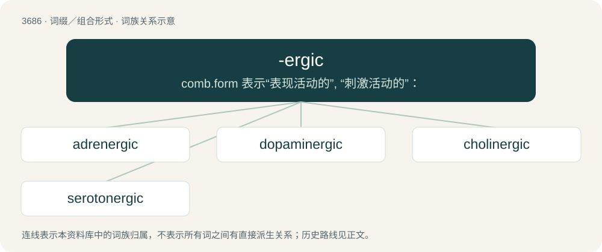

# 3736 · -ergic — comb.form 表示“表现活动的”, “刺激活动的”：

[总目录](../00_总目录_按常用程度.md)

**类型**：词缀／组合形式　｜　**来源语言**：见词源记录

## 核心含义与来源

- 核心含义：comb.form 表示“表现活动的”, “刺激活动的”：
- 英文含义：Produced or activated by (the specified thing).
- 词形：-ergic

**来源记录 1**（后缀／后置成分；Produced or activated by (the specified thing).）

From -ergy + -ic.

## 词族图

## 单词速览（常用到不常用）

| 单词 | 音标 | 释义 |
|---|---|---|
| [adrenergic](#w-1) | /,ædriˈnəːdʒik/ | a. 肾上腺素能的, 释放出肾上腺素的；\[医\] 肾上腺素能的(神经) |
| [dopaminergic](#w-2) | 英 /ˌdəʊ.pə.mɪˈnɜː.d͡ʒɪk/；美 /ˌdoʊ.pə.mɪˈnɝ.d͡ʒɪk/ | a. \[生\]多巴胺能的 |
| [cholinergic](#w-3) | /,kəuliˈnəːdʒik/ | a. 胆碱能的, 类似乙酰胆碱的, 被乙酰胆碱活化的, 释放出乙酰胆碱的；n. 胆碱能药, 拟副交感神经药 |
| [serotonergic](#w-4) | /ˌsɛrətəˈnɜːrd͡ʒɪk/ | a. \[生理\]含血清素的, 血清素激活的 |

## 逐词详解

### 1. adrenergic

**词性**：形容词　｜　**音标**：/,ædriˈnəːdʒik/

**中文释义**：a. 肾上腺素能的, 释放出肾上腺素的；\[医\] 肾上腺素能的(神经)

**英文义项**：Having the quality of adrenaline or epinephrine. / Containing or releasing adrenaline.

**构词拆分**：adren- + -ergic

**词源与演化**：

From adren- + -ergic.

### 2. dopaminergic

**词性**：形容词　｜　**音标**：英 /ˌdəʊ.pə.mɪˈnɜː.d͡ʒɪk/；美 /ˌdoʊ.pə.mɪˈnɝ.d͡ʒɪk/

**中文释义**：a. \[生\]多巴胺能的

**英文义项**：Containing, involving, or transmitting dopamine; involving dopamine receptor agonism.

**构词拆分**：dopamine + -ergic

**词源与演化**：

From dopamine + -ergic.

**例句**：

> The nucleus accumbens is one of the most studied nuclei in the dopaminergic system.

该用例对应义项：Containing, involving, or transmitting dopamine; involving dopamine receptor agonism.

### 3. cholinergic

**词性**：形容词　｜　**音标**：/,kəuliˈnəːdʒik/

**中文释义**：a. 胆碱能的, 类似乙酰胆碱的, 被乙酰胆碱活化的, 释放出乙酰胆碱的；n. 胆碱能药, 拟副交感神经药

**英文义项**：Of, pertaining to, activated by, producing or having the same function as acetylcholine.

**构词拆分**：choline + -ergic

**词源与演化**：

From choline + -ergic.

### 4. serotonergic

**词性**：形容词　｜　**音标**：/ˌsɛrətəˈnɜːrd͡ʒɪk/

**中文释义**：a. \[生理\]含血清素的, 血清素激活的

**英文义项**：Containing or releasing serotonin. / Involved in, or capable of modulating activity in, neurotransmission pathways that use serotonin receptor proteins.

**构词拆分**：serotonin + -ergic

**词源与演化**：

From seroton(in) + -ergic.
