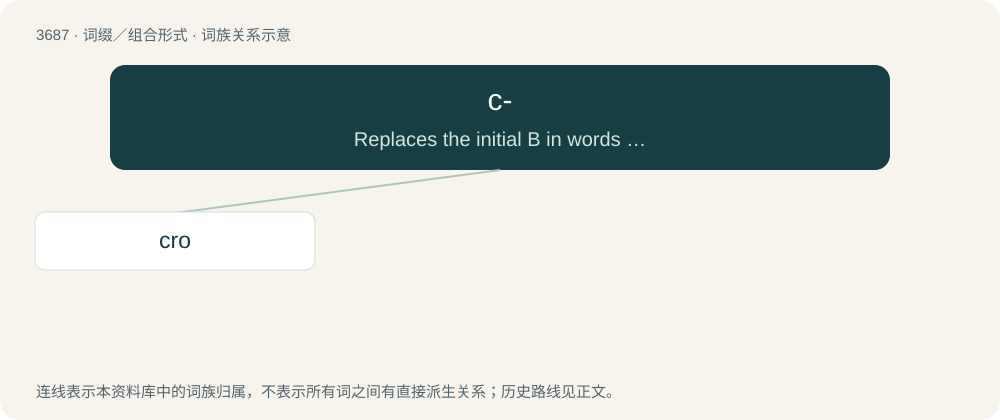

# 3737 · c- — Replaces the initial B in words to avoid association with the Bloods.

[总目录](../00_总目录_按常用程度.md)

**类型**：词缀／组合形式　｜　**来源语言**：见词源记录

## 核心含义与来源

- 核心含义：Replaces the initial B in words to avoid association with the Bloods.
- 英文含义：Replaces the initial B in words to avoid association with the Bloods.
- 词形：c-

**来源记录 1**（前缀／前置成分；Replaces the initial B in words to avoid association with the Bloods.）

From Crip.

## 词族图

## 单词速览（常用到不常用）

| 单词 | 音标 | 释义 |
|---|---|---|
| [cro](#w-1) | 英 /kɹəʊ/；美 /kɹoʊ/ | 阴极射线示波器（Cathode-Ray Oscillograph） |

## 逐词详解

### 1. cro

**词性**：名词　｜　**音标**：英 /kɹəʊ/；美 /kɹoʊ/

**中文释义**：阴极射线示波器（Cathode-Ray Oscillograph）

**英文义项**：Synonym of bro (“a male comrade or friend”).

**构词拆分**：c- + bro

**词源与演化**：

From c- (“Crip”) + bro.
