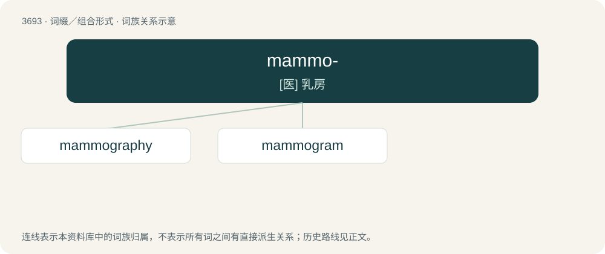

# 3741 · mammo- — \[医\] 乳房

[总目录](../00_总目录_按常用程度.md)

**类型**：词缀／组合形式　｜　**来源语言**：见词源记录

## 核心含义与来源

- 核心含义：\[医\] 乳房
- 英文含义：relating to the mammary organs (mammary glands, breasts, udders, and dugs), or to females
- 词形：mammo-

**来源记录 1**（前缀／前置成分；relating to the mammary organs (mammary glands, breasts, udders, and dugs), or to females）

New Latin combining form, from Latin mamma (noun, literally “female breast”), ultimately cognate with mama and mom.

## 词族图

## 单词速览（常用到不常用）

| 单词 | 音标 | 释义 |
|---|---|---|
| [mammography](#w-1) | /məˈmɔ^rəfi/ | n. 早期胸部肿瘤X射线测定法；\[医\] 乳房X线照相术 |
| [mammogram](#w-2) | /ˈmæmə,^ræm/ | \[医\] 乳房X线照片 |

## 逐词详解

### 1. mammography

**词性**：名词　｜　**音标**：/məˈmɔ^rəfi/

**中文释义**：n. 早期胸部肿瘤X射线测定法；\[医\] 乳房X线照相术

**英文义项**：X-ray examination of the breasts for diagnosing and locating abnormalities, especially tumours.

**构词拆分**：mammo- + -graphy

**词源与演化**：

From mammo- + -graphy.

**例句**：

> Mammography can mean the difference between life and death for millions of women.

### 2. mammogram

**词性**：名词　｜　**音标**：/ˈmæmə,^ræm/

**中文释义**：\[医\] 乳房X线照片

**英文义项**：An X-ray picture of the breasts (mammaries), used to screen for breast cancer.

**构词拆分**：mammo- + -gram

**词源与演化**：

From mammo- + -gram.

**例句**：

> It's recommended that you get a mammogram every year.
